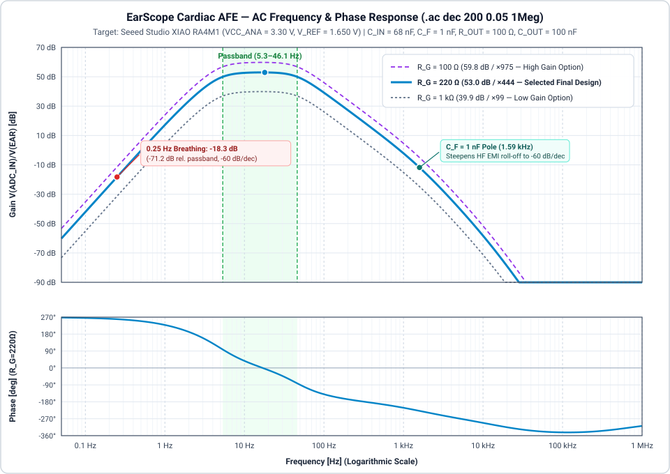

# EarScope — In-Ear Bio-Acoustic Cardiac Monitor (Arduino Nano R4 Edition)

**EarScope** is an ultra-low-noise, compact hardware and software acquisition platform that captures acoustic and micro-mechanical cardiac biosignals (**PCG**, **SCG**, and **GCG**) directly from an occluded ear canal using standard wired earphones (`3.5 mm` AUX), inspired by *LubDubDecoder (ACM CHI '26)*.

> **Project Engineering Documentation & Hardware Files:**
> * **[Turnkey PCB Fabrication & JLCPCB PCBA Package (`fabrication_files/`)](fabrication_files/)** — Ready-to-order Gerber/Drill ZIP ([`EarScope_NanoR4_Gerbers_JLCPCB.zip`](fabrication_files/EarScope_NanoR4_Gerbers_JLCPCB.zip)), unpacked RS-274X Gerbers + Excellon Drills, LCSC BOM + CPL CSVs, and ordering guide.
> * **[LTspice Finalization, Verification & Simulation Results](docs/ltspice_simulation_guide.md)** — Validated `3.30 V` ratiometric schematic ([`AFE_Cardiac_5-45Hz.asc`](docs/AFE_Cardiac_5-45Hz.asc) + [`OPA365.lib`](docs/OPA365.lib)), rationale, and verification plots.
> * **[Fabrication-Ready KiCad 8 / 9 Project (`hardware_pcb/EarScope_NanoR4/`)](hardware_pcb/EarScope_NanoR4/)** — Complete editable schematic (`.kicad_sch`), `100%` routed `68.0 × 20.0 mm` 2-layer PCB (`.kicad_pcb`), and custom footprint library (`.pretty`).
> * **[KiCad 8 / 9 Integrated SPICE (`ngspice`) Simulation Guide & 1-Click Testbench](docs/kicad_spice_simulation_guide.md)** — Ready-to-run KiCad SPICE project ([`hardware_pcb/EarScope_SPICE_Sim/`](hardware_pcb/EarScope_SPICE_Sim/) with [`OPA2365_Dual.lib`](hardware_pcb/EarScope_SPICE_Sim/OPA2365_Dual.lib)) + step-by-step `OP`, `AC` Bode, and `TRAN` verification instructions.
> * **[`kicad-happy` Automated Design Review & Fabrication Release Gate (`11/11 PASS`)](docs/kicad_happy_design_review.md)** — Full electrical, Gerber/CAM, DFM (`0` violations), and EMC (`98.5 / 100`) sign-off via [`aklofas/kicad-happy`](https://github.com/aklofas/kicad-happy).
> * **[KiCad 8 / 9 Schematic & PCB Design Guide](docs/kicad_pcb_design_guide.md)** — Complete symbol/footprint mapping, custom castellated Nano R4 footprint, `68.0 × 20.0 mm` 2-layer layout, active `VREF` guard ring, and Gerber export.
> * **Enclosure & Carrier PCB Co-Design Guide** (`docs/fusion360_enclosure_guide.md` — *Arduino Nano R4 `68 × 20 mm` mechanical revision next*).

---

## 1. System Architecture Overview

EarScope converts microscopic tympanic/ear-canal pressure oscillations (`5 Hz – 45 Hz`) into a high-resolution digital stream over **USB-C**:

* **Sensor Input (`3.5 mm` AUX `PJ-320A` + External `SW1` Slide Switch):** Supports standard passive dynamic earphones (`16–32 Ω` voice coil operating in reverse as a zero-bias acoustic transducer via the ear-canal occlusion effect) **and** electret microphone capsules at the flick of an external side slide switch (**`SW1: EAR ↔ MIC`**, toggling `2.2 kΩ` DC bias on `VCC_ANA`).
* **Cardiac Analog Front-End (`OPA2365` × 2):** Dual ultra-low-noise (`4.5 nV/√Hz`), rail-to-rail CMOS operational amplifiers configured as a breathing-protected `53.2 dB` preamplifier followed by a 4th-order Butterworth `5 Hz – 45 Hz` bandpass filter (`-60 dB/decade` sub-cardiac slope including input coupling).
* **Ratiometric `3.30 V` Analog Island (`VCC_ANA` = `AREF`):** A dedicated low-noise LDO (`MCP1700T-3302E/TT`) steps the noisy USB `+5 V` rail down to a quiet **`3.300 V`** supply powering both `OPA2365` ICs, the symmetric **`1.650 V`** virtual-ground buffer, **and** the external ADC reference pin (**`AREF`**) of the **Arduino Nano R4**.
* **Digital Acquisition & Streaming (`Arduino Nano R4` / `ABX00142`):** Powered by the **Renesas `RA4M1`** (`48 MHz` Arm Cortex-M4F with FPU), sampling at `500 Hz` with a **true 14-bit SAR ADC** (`0–16,383` counts, `1 LSB = 201.4 µV`) and zero Wi-Fi/BLE RF burst interference, streaming real-time packets over onboard **USB-C** to Python DSP & deep-learning waveform reconstruction software.

```text
[Earphones / Mic (3.5mm AUX + SW1)] ---> [Cardiac AFE (OPA2365, 5–45Hz, 3.30V LDO)] ---> [Arduino Nano R4 14-Bit ADC (Pin A1, AREF=3.30V)] ===(USB-C @ 500Hz)===> [PC / Python UI]
```

---

## 2. Target Physiological Signals

1. **Phonocardiography (PCG):** Audible and sub-audible heart valve closure sounds (`S1` *"Lub"* and `S2` *"Dub"*).
2. **Seismocardiography (SCG) & Gyrocardiography (GCG):** Reconstruction of chest-wall micro-mechanical cardiac vibrations coupled acoustically through the vasculature and skull into the sealed ear canal.
3. **Cardiac Fiducial Timing Landmarks:**
   * **MC** — Mitral Valve Closure
   * **IM** — Isovolumetric Moment
   * **AO** — Aortic Valve Opening
   * **MA** — Maximal Acceleration
   * **RE** — Rapid Ejection

---

## 3. Finalized Analog Front-End (AFE) Design

The production schematic (`AFE_Cardiac_5-45Hz.asc`) comprises five tightly coordinated analog blocks:

### 3.1 Ratiometric Virtual Ground Buffer (`U2B`)
A symmetric `1%` thin-film divider ($R_{\text{REF1}} = 100\text{ k}\Omega$, $R_{\text{REF2}} = 100\text{ k}\Omega$) filtered by $C_{\text{REF}} = 10\text{ }\mu\text{F}$ ($f_c \approx 0.32\text{ Hz}$ on `U2B+`) establishes a rock-solid mid-supply reference:

$$
V_{\text{REF}} = V_{\text{CC\_ANA}} \cdot \frac{R_{\text{REF2}}}{R_{\text{REF1}} + R_{\text{REF2}}} = 3.300\text{ V} \cdot \frac{100\text{ k}\Omega}{100\text{ k}\Omega + 100\text{ k}\Omega} = 1.650\text{ V} \quad (\text{14-bit ADC Code } 8192)
$$

### 3.2 Input Coupling, Breathing Motion Pre-Filter (`C_IN = 68 nF`) & `SW1` (`EAR ↔ MIC`) Switch
In occluded ear canals, slow respiratory pressure waves (`0.2 – 0.4 Hz`) reach **`~5 mV` peak** — more than `15×` stronger than in-ear cardiac `S1/S2` pulses. Setting $C_{\text{IN}} = 68\text{ nF}$ against $R_{\text{BIAS}} = 1\text{ M}\Omega$ creates a passive high-pass corner ahead of Stage 1:

$$
f_{c,\text{in}} = \frac{1}{2\pi R_{\text{BIAS}} C_{\text{IN}}} = \frac{1}{2\pi \cdot 1\text{ M}\Omega \cdot 68\text{ nF}} \approx 2.34\text{ Hz}
$$

This pre-attenuates `0.25 Hz` breathing artifacts by **`8×` (`-18.0 dB`) *before* preamplification**, completely preventing Stage 1 rail saturation while incurring `< 0.07 dB` loss at `18 Hz`. Ahead of $C_{\text{IN}}$, an external side-actuated SMD slide switch (**`SW1`**, `C&K PCM12SMTR` / `MSK12C02`) switches **`R_MIC = 2.2 kΩ`** to `VCC_ANA` ON for electret microphone capsules (`MIC` position) or completely disconnects it (`EAR` position) so zero DC current flows through `16–32 Ω` passive earphone voice coils. Because `SW1` sits on the low-impedance `VCC_ANA` side of `R_MIC` with a grounded metal shell, touching the switch introduces zero `50 Hz` finger hum.

### 3.3 Stage 1 Low-Noise Non-Inverting Preamplifier (`U1A`)
Selected production gain uses **$R_G = 220\text{ }\Omega$** with $R_F = 100\text{ k}\Omega$ in parallel with **$C_F = 1\text{ nF}$**:

$$
G_1 = 1 + \frac{R_F}{R_G} = 1 + \frac{100\text{ k}\Omega}{220\text{ }\Omega} = 455.5 \approx 53.2\text{ dB}, \qquad f_{p,\text{EMI}} = \frac{1}{2\pi R_F C_F} \approx 1.59\text{ kHz}
$$

* Balances high SNR for low-impedance passive earphones (`16–32 Ω`) with wide linear headroom (`> 1.38 V` margin to both rails under `5 mV` breathing waves) and rolls off RF/EMI picked up by the earphone cable above `1.59 kHz`.
* Dual `0805` pads (or a low-profile `3 × 3 mm` SMD trimmer) allow easy population of `1 kΩ` (`40.1 dB`) or `100 Ω` (`60.0 dB`).

### 3.4 Stage 2 (`5 Hz` HPF, `U1B`) & Stage 3 (`45 Hz` LPF, `U2A`)
* **Stage 2 — 2nd-Order Butterworth Sallen-Key HPF (`U1B`):** $C_{1H} = C_{2H} = 1\text{ }\mu\text{F}$, $R_{AH} = 22.6\text{ k}\Omega$ (feedback to `U1B` output), $R_{BH} = 45.3\text{ k}\Omega$ (to `VREF`), $f_c \approx 4.97\text{ Hz}$. Strips Stage 1 amplified DC offset ($V_{\text{OS}} \times 455.5$) and combines with $C_{\text{IN}}$ for `-60 dB/decade` sub-cardiac rejection.
* **Stage 3 — 2nd-Order Butterworth Sallen-Key LPF (`U2A`):** $R_{1L} = R_{2L} = 24.9\text{ k}\Omega$, $C_{AL} = 200\text{ nF}$, $C_{BL} = 100\text{ nF}$ (referenced directly to **`VREF`**), $f_c \approx 45.2\text{ Hz}$.

### 3.5 Stage 4 — 14-Bit SAR ADC Charge-Reservoir Filter
A passive output filter (**$R_{\text{OUT}} = 100\text{ }\Omega$**, **$C_{\text{OUT}} = 100\text{ nF}$** to `GND`, $f_c \approx 15.9\text{ kHz}$) isolates `U2A` from capacitive loading and absorbs switched-capacitor sampling kickback from the Renesas `RA4M1` 14-bit SAR ADC (`< 0.35 LSB` settling error at `500 Hz`).

---

## 4. Validated LTspice Simulation Results

Full SPICE verification instructions and waveforms are available in [`docs/ltspice_simulation_guide.md`](docs/ltspice_simulation_guide.md).

| Parameter | Final Simulated Value (`R_G = 220 Ω`, `C_IN = 68 nF`) |
| :--- | :--- |
| **Analog Supply & ADC Reference (`VCC_ANA = AREF`)** | `3.300 V` (`1 LSB = 201.4 µV` @ 14-bit) |
| **Quiescent Output (`V(ADC_IN)`)** | `1.650 V` (14-bit ADC center code `8192`) |
| **Net Mid-Band Gain (`@ 18 Hz`)** | **`52.95 dB` (`×444.3`)** |
| **System `-3 dB` Passband** | **`5.34 Hz – 46.12 Hz`** |
| **Breathing Rejection (`@ 0.25 Hz`)** | **`-71.2 dB` relative to passband** (`3,630×` attenuation) |
| **Stage 1 Swing under `5 mV`, `0.25 Hz` Breathing** | `1.408 V – 1.892 V` (**zero clipping**, `> 1.38 V` rail margin) |
| **Integrated Input-Referred Noise (`5–45 Hz`)** | **`0.141 µVrms`** (`63.3 µVrms` = **`0.31 LSBrms`** at `ADC_IN`) |
| **Power-Up Soft-Start Time** | **`~2.3 s`** smooth exponential settling |




---

## 5. Arduino Nano R4 Interface & Firmware Configuration

### 5.1 Hardware Pin Mapping (`Arduino Nano R4` / `ABX00142`)

| Carrier PCB Signal | Nano R4 Pin | `RA4M1` Pin | Function & Routing Notes |
| :--- | :--- | :--- | :--- |
| **`+5V_USB`** | **`+5V`** (`JP2` Pin 12) | VUSB (via Schottky `D1`) | Feeds input of `U3` (`MCP1700T-3302E/TT` `3.3 V` LDO) |
| **`VCC_ANA` (`3.30 V`)** | **`AREF`** (`JP1` Pin 3) | `P010 / VREFH0` | External precision 14-bit ADC full-scale reference + `100 nF` to `GND` |
| **`ADC_IN`** | **`A1`** (`JP1` Pin 5) | `P000 / AN000` | Dedicated 14-bit SAR ADC input (avoids `A0` DAC mux & `A4/A5` I2C) |
| **`GND`** | **`GND`** (`JP1` Pin 14 / `JP2` Pin 14) | `VSS / AVSS0` | Continuous solid ground plane bond |

### 5.2 Reference Arduino Nano R4 Acquisition Setup (`C++`)

```cpp
#include <Arduino.h>

constexpr uint8_t PIN_CARDIAC_ADC = A1;
constexpr uint32_t SAMPLE_PERIOD_US = 2000; // 500 Hz exact sampling rate

void setup() {
  Serial.begin(230400);
  analogReference(AR_EXTERNAL); // Lock full-scale ADC span to VCC_ANA (3.300 V) on AREF
  analogReadResolution(14);     // Enable true 14-bit SAR resolution (0 .. 16383, mid = 8192)
}

void loop() {
  static uint32_t lastSampleUs = 0;
  uint32_t nowUs = micros();
  if (nowUs - lastSampleUs >= SAMPLE_PERIOD_US) {
    lastSampleUs += SAMPLE_PERIOD_US;
    uint16_t raw14 = analogRead(PIN_CARDIAC_ADC);
    Serial.println(raw14);
  }
}
```

---

## 6. Fabrication-Ready KiCad 8 / 9 Carrier PCB & `kicad-happy` Verification (`PASS`)

The editable KiCad 8/9 source project lives in [`hardware_pcb/EarScope_NanoR4/`](hardware_pcb/EarScope_NanoR4/), while the ready-to-order manufacturing package lives in [`fabrication_files/`](fabrication_files/). All design and CAM files passed **`11 / 11` automated release-gate checks** in [`aklofas/kicad-happy`](https://github.com/aklofas/kicad-happy) (full audit in [`docs/kicad_happy_design_review.md`](docs/kicad_happy_design_review.md)):

* **Routing & Parity:** `44 / 44` schematic-to-PCB net parity (`17 / 17` active multi-pad nets `100%` routed with `45°` octile geometry, `0` unrouted nets, `52` vias including `31` `GND` return-path stitching vias over an unbroken `B.Cu` `GND` plane).
* **DFM & Clearances:** **`standard` (`$2`) 2-layer tier** with **`0` DFM violations**, `0` courtyard overlaps, `0` silkscreen-pad overlaps (`min_track = 0.25 mm`, `min_drill = 0.30 mm`, `min_annular_ring = 0.15 mm`).
* **Gerber & Drill CAM Audit:** **`0` findings (`Complete`)** — all `9/9` RS-274X (X2) Gerber layers + `PTH.drl` (`52` vias) + `NPTH.drl` (`4` alignment holes) + `.gbrjob` bundled in [`EarScope_NanoR4_Gerbers_JLCPCB.zip`](fabrication_files/EarScope_NanoR4_Gerbers_JLCPCB.zip).
* **EMC & ESD Sign-Off:** **`97.0 / 100` EMC score (`0` errors)** — bidirectional low-capacitance ESD diode **`D1` (`PESD3V3L1BA`, `SOD-323`)** right at `J1` (`PJ-320A`), decoupling capacitors `< 2 mm` from `U1`, `U2`, and `AREF`, and companion `GND` stitching vias beside any layer transition.
* **Turnkey PCBA Outputs:** Ready-to-upload [`EarScope_JLCPCB_BOM.csv`](fabrication_files/EarScope_JLCPCB_BOM.csv) (`19` LCSC lines / `30` SMD parts) and [`EarScope_JLCPCB_CPL.csv`](fabrication_files/EarScope_JLCPCB_CPL.csv) (`30` placement rows; `A1` Nano R4 hand-soldered flush via castellated pads).


---

## 7. Production Bill of Materials (BOM)

All passive components use **`0805` SMD** packages for straightforward hand soldering or turnkey PCBA (`JLCPCB` / `PCBWay`).

| Designator | Value / Part Number | Package / Footprint | Qty | Engineering Notes |
| :--- | :--- | :--- | :---: | :--- |
| **A1 (MCU)** | `Arduino Nano R4` (`ABX00142`) | Castellated SMD (`2×15`, `45×18 mm`) | 1 | Flush-mounted via castellated pads (no pin headers); onboard USB-C |
| **U1, U2** | `OPA2365AIDR` | SOIC-8 | 2 | Dual `4.5 nV/√Hz`, zero-crossover rail-to-rail CMOS op-amp |
| **U3** | `MCP1700T-3302E/TT` | SOT-23-3 | 1 | Low-noise `3.30 V` LDO powering `+3V3_ANA` (`VCC_ANA`) + Nano R4 `AREF` |
| **D1** | `PESD3V3L1BA` | SOD-323 | 1 | Low-capacitance bidirectional `3.3 V` ESD clamp on `J1` (`VIN_RAW`, LCSC `C15772`) |
| **J1** | `PJ-320A` (3.5 mm TRRS) | SMD (`12.1 × 6.1 × 5.0 mm`) | 1 | Earphone / headset AUX input receptacle (`Tip` = signal, `Ring2+Sleeve` = `GND`) |
| **SW1** | `C&K PCM12SMTR` / `MSK12C02` | `SW_SPDT_PCM12` (`6.7×2.6 mm`) | 1 | External side slide switch (`EAR` = Bias OFF, `MIC` = `2.2 kΩ` Bias ON) |
| **C1 (`C_IN`)** | `68 nF` | 0805 (`C0G/NP0` or `X7R`, `≥25 V`) | 1 | `2.34 Hz` breathing pre-filter (`C0G` preferred to eliminate piezo microphonics) |
| **C2 (`C_F`)** | `1 nF` | 0805 (`C0G/NP0`) | 1 | Stage 1 feedback HF/EMI roll-off (`1.59 kHz`) across `R_F` |
| **C3, C4 (`C_1H, C_2H`)** | `1 µF` | 0805 (`X7R`, `≥16 V`) | 2 | Stage 2 `5 Hz` Sallen-Key HPF capacitors |
| **C5 (`C_AL`)** | `200 nF` (or `2 × 100 nF` parallel) | 0805 (`C0G` or `X7R`) | 1 | Stage 3 `45 Hz` Sallen-Key LPF feedback capacitor |
| **C6, C7 (`C_BL, C_OUT`)** | `100 nF` | 0805 (`C0G` or `X7R`) | 2 | `C6` tied to **`VREF`**; `C7` tied to **`GND`** right at Nano R4 `A1` |
| **C11–C13 (`C_DEC1..CAREF`)** | `100 nF` | 0805 (`X7R`) | 3 | Local bypass (`< 2 mm`) on `U1`, `U2`, and Nano R4 `AREF` pin |
| **C8–C10 (`C_REF, CLDO`)** | `10 µF` | 0805 (`X7R`, `≥10 V`) | 3 | `VREF_DIV` noise filter (`U2B+`) and LDO input/output stabilization |
| **R4–R6 (`R_F, R_REF1/2`)** | `100 kΩ` (`1%`) | 0805 (Thin Film) | 3 | Stage 1 feedback resistor and symmetric `1.650 V` divider |
| **R1 (`R_BIAS`)** | `1 MΩ` (`1%`) | 0805 | 1 | Input DC bias reference to `VREF` |
| **R2 (`R_G`), R3 (`DNP`)** | `220 Ω` (`1%`) + `DNP` alt pad | 0805 | 1 + 1 | Selected Stage 1 gain (`×455.5` / `53.2 dB`) + parallel trim footprint |
| **R7, R8 (`R_AH, R_BH`)** | `22.6 kΩ`, `45.3 kΩ` (`1%`) | 0805 | 1 ea | Stage 2 `5 Hz` Butterworth Sallen-Key HPF resistors |
| **R9, R10 (`R_1L, R_2L`)** | `24.9 kΩ` (`1%`) | 0805 | 2 | Stage 3 `45 Hz` Butterworth Sallen-Key LPF resistors |
| **R11 (`R_OUT`)** | `100 Ω` (`1%`) | 0805 | 1 | Isolates `U2A` output from `C7` SAR charge reservoir |
| **R12 (`R_MIC`)** | `2.2 kΩ` (`1%`) | 0805 | 1 | Electret capsule bias pull-up in series with `SW1` (`+3V3_ANA` side) |

---

## 8. Repository Structure

```text
EarScope/
├── README.md                                       # Main system architecture, BOM & results (English)
├── fabrication_files/                              # Ready-to-order PCB & PCBA manufacturing package
│   ├── README.md                                   # JLCPCB / PCBWay ordering & Nano R4 soldering guide
│   ├── EarScope_NanoR4_Gerbers_JLCPCB.zip          # Single-upload Gerber RS-274X + Excellon Drill ZIP
│   ├── EarScope_JLCPCB_BOM.csv                     # Turnkey LCSC SMT Bill of Materials (19 lines / 30 parts)
│   ├── EarScope_JLCPCB_CPL.csv                     # Turnkey Pick-and-Place coordinates (mm, Top side)
│   ├── EarScope_Master_BOM.csv                     # Full 31-part engineering BOM (incl. Nano R4)
│   └── gerbers/                                    # Unpacked .gbr, .drl & .gbrjob CAM layers
├── docs/
│   ├── AFE_Cardiac_5-45Hz.asc                      # Finalized LTspice 26 schematic (Arduino Nano R4 target)
│   ├── OPA365.lib                                  # Texas Instruments OPA365 / OPA2365 SPICE macro-model
│   ├── ltspice_simulation_guide.md                 # LTspice verification guide & benchmark results
│   ├── kicad_pcb_design_guide.md                   # Step-by-step KiCad 8/9 schematic, PCB layout & Gerber guide
│   ├── kicad_happy_design_review.md                # Automated kicad-happy PCB review & PASS release gate report
│   ├── fusion360_enclosure_guide.md                # Parametric 3D enclosure & PCB co-design guide
│   └── figures/                                    # Verification waveforms & PCB layout SVG diagrams
│       ├── afe_bode_response.svg
│       ├── cin_preamp_saturation_comparison.svg
│       ├── transient_startup_and_cardiac_output.svg
│       ├── input_referred_noise_spectrum.svg
│       ├── kicad_pcb_floorplan.svg
│       └── earscope_routed_pcb.svg
├── hardware_pcb/
│   └── EarScope_NanoR4/                            # Editable KiCad 8/9 source project & custom footprints
│       ├── EarScope_NanoR4.kicad_pro
│       ├── EarScope_NanoR4.kicad_sch               # 37 symbols (31 BOM parts + TP1–TP6), 44 nets
│       ├── EarScope_NanoR4.kicad_pcb               # 68.0 × 20.0 mm 2-layer 100% routed carrier PCB
│       ├── fp-lib-table
│       ├── EarScope_Footprints.pretty/             # 9 custom/verified SMD footprints (.kicad_mod)
│       └── bom/                                    # Source BOM & CPL exports
├── firmware_nano_r4/                               # Arduino Nano R4 (RA4M1) 14-bit 500 Hz USB-C streamer
└── software_pc/                                    # Python real-time visualization & SCG/GCG reconstruction
```