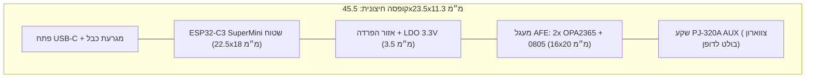

# מדריך תכנון פרמטרי ב-Fusion 360: קופסה זעירה ל-EarScope (ESP32-C3 SuperMini USB-C + AUX)

מדריך זה מגדיר במקביל (Co-Design) את המידות המינימליות של מעגל ה-PCB מתוך [readme.md](../readme.md) ואת מארז ההדפסה בתלת-ממד עבור ארכיטקטורת **`ESP32-C3 SuperMini`** – תוך שימוש ישיר בשקע ה-**USB-C המובנה** שעל ה-SuperMini בצד אחד ובשקע ה-**AUX (`PJ-320A`)** בצד השני.

* **מידות ה-PCB המינימליות:** **`42.0 × 20.0 × 1.6 mm`**
* **מידות הקופסה החיצוניות הכוללות:** **`45.5 × 23.5 × 11.3 mm`** (`4.55 × 2.35 × 1.13 cm` – קטנה מקופסת גפרורים!)
* **שיטת הרכבה והדפסה:** שני חצאים (בסיס ומכסה) הננעלים ב-**Snap-Fit** ללא ברגים, מצמידים את הלוח ב-4 פינותיו, ומודפסים ב-**100% ללא תמיכות (Zero Supports)**.

---

## 1. עקרונות התכנון המכני (לפני שמתחילים ב-Fusion 360)

1. **הלחמה שטוחה של ה-`ESP32-C3 SuperMini` (`22.52 × 18.0 mm`):**
   ללוח ה-SuperMini אין רכיבים בצדו התחתון ויש לו חצאי-חורים משוננים (Castellated Pads) בצדדים. מלחימים אותו **שטוח לחלוטין על פני ה-PCB העליונים** (ללא פיני Header!), כשהקצה השמאלי שלו צמוד לקצה השמאלי של ה-PCB שלנו.
2. **שקע ה-USB-C המובנה ומגרעת לכבל (Cable Boot Relief):**
   שקע ה-USB-C יושב על גבי ה-SuperMini (עובי לוח ה-SuperMini כולל הלחמה הוא `~1.2 mm`, וגובה שקע ה-USB-C הוא `3.26 mm`), כך שמרכז שקע ה-USB-C נמצא בגובה **`2.8 mm` מעל פני ה-PCB הראשי**. מכיוון ששקע ה-USB-C בולט רק ב-`~0.8 mm` מעבר לקצה הלוח בזמן שדופן הקופסה + מרווח האוויר הם `1.75 mm`, נוסיף בדופן החיצונית **מגרעת שקועה בעומק `0.8 mm`** סביב חור ה-USB-C – כך שכל כבל USB-C (גם עבה במיוחד) ייכנס עד הסוף ב"קליק" מלא ולא ייתקע בפלסטיק!
3. **שקע ה-AUX (`PJ-320A` 3.5mm TRRS):**
   גוף השקע (`12.1 × 6.1 × 5.0 mm`) יושב בקצה הימני של הלוח, כשהצווארון העגול שלו (`Ø5.0 mm`, אורך `2.0 mm`, מרכז בגובה **`2.5 mm` מעל הלוח**) בולט החוצה אל תוך דופן הקופסה הימנית (`1.5 mm`).
4. **סגירת Snap-Fit וגישה לכפתור `BOOT`:**
   ברגע שמוגדר בקושחה `USB CDC On Boot = Enabled`, צריבת קוד מתבצעת אוטומטית מהמחשב ללא לחיצה על כפתורים. אם אי-פעם נדרש איפוס קשיח עם כפתור ה-`BOOT` שעל ה-SuperMini, המכסה נפתח בציפורן בשנייה אחת ונסגר חזרה בקליק ללא שום בורג.

---

## 2. שלב 0: פתיחת פרויקט והזנת טבלת User Parameters

כל המודל ב-Fusion 360 מבוסס על פרמטרים ונוסחאות – שינוי מידה אחת בטבלה יעדכן אוטומטית את כל הגופים והפתחים.

1. פתח עיצוב חדש ב-Fusion 360 וודא ב-**Browser** משמאל ש-**Document Settings -> Units** מוגדר ל-`mm`.
2. שמור את הקובץ בשם `EarScope_C3_Enclosure`.
3. בתפריט העליון לחץ על **Modify -> Change Parameters** (או הקש `S` והקלד `Change Parameters`).
4. לחץ על **`+` (User Parameter)** והזן תחילה את הפרמטרים הקבועים ולאחריהם את הנוסחאות המחושבות:

### א. פרמטרים קבועים (ערכי בסיס)

| Name (שם ב-Fusion) | Unit | Expression (ערך) | תפקיד והסבר הנדסי |
| :--- | :---: | :---: | :--- |
| `pcb_l` | `mm` | `42.0` | אורך הלוח הכולל (`22.5mm` SuperMini + `3.5mm` חיץ + `16mm` AFE/AUX) |
| `pcb_w` | `mm` | `20.0` | רוחב הלוח (`18.0mm` רוחב ה-SuperMini + `1.0mm` מכל צד להלחמה) |
| `pcb_t` | `mm` | `1.6` | עובי PCB סטנדרטי ב-JLCPCB |
| `pcb_tol` | `mm` | `0.25` | מרווח חופש היקפי בין הלוח לדופן הקופסה |
| `wall` | `mm` | `1.5` | עובי דופן הקופסה (מותאם ל-3–4 קווי דופן בדיזה `0.4 mm`) |
| `bot_clear` | `mm` | `1.2` | גובה מדרגות התמיכה מתחת ללוח (מקום לפיני מיקום של שקע ה-AUX) |
| `top_clear` | `mm` | `5.5` | מרווח מעל הלוח (`5.0 mm` גובה שקע ה-AUX + `0.5 mm` מרווח ביטחון) |
| `usb_w` | `mm` | `9.5` | רוחב חלון שקע USB-C (`8.94 mm` תקני + טולרנס הדפסה) |
| `usb_h` | `mm` | `3.8` | גובה חלון שקע USB-C (`3.26 mm` תקני + טולרנס הדפסה) |
| `usb_center_h` | `mm` | `2.8` | גובה מרכז שקע ה-USB-C מעל פני ה-PCB הראשי (`1.2mm` לוח C3 + חצי שקע) |
| `usb_recess_d` | `mm` | `0.8` | עומק מגרעת חיצונית לראש פלסטיק של כבל USB-C |
| `aux_d` | `mm` | `5.4` | קוטר חור צווארון שקע ה-AUX (`5.0 mm` + `0.4 mm` טולרנס) |
| `aux_center_h` | `mm` | `2.5` | גובה מרכז חור ה-AUX מעל פני ה-PCB הראשי (לפי דפי נתונים של `PJ-320A`) |
| `ledge_size` | `mm` | `2.5` | גודל עמודי התמיכה וההידוק ב-4 פינות הלוח (`2.5 × 2.5 mm`) |
| `lip_h` | `mm` | `1.2` | גובה שפת הנעילה (Lip) בין הבסיס למכסה |
| `fit_tol` | `mm` | `0.15` | טולרנס התאמה בין חלקים מודפסים |

### ב. פרמטרים מחושבים (נוסחאות אוטומטיות)

| Name (שם ב-Fusion) | Unit | Expression (העתק בדיוק) | תוצאה נוכחית | משמעות |
| :--- | :---: | :--- | :---: | :--- |
| `inner_l` | `mm` | `pcb_l + 2 * pcb_tol` | `42.5 mm` | אורך חלל פנימי |
| `inner_w` | `mm` | `pcb_w + 2 * pcb_tol` | `20.5 mm` | רוחב חלל פנימי |
| `box_l` | `mm` | `inner_l + 2 * wall` | `45.5 mm` | אורך חיצוני כולל של הקופסה |
| `box_w` | `mm` | `inner_w + 2 * wall` | `23.5 mm` | רוחב חיצוני כולל של הקופסה |
| `box_h` | `mm` | `2 * wall + bot_clear + pcb_t + top_clear` | `11.3 mm` | גובה חיצוני כולל של הקופסה |
| `pcb_top_z` | `mm` | `wall + bot_clear + pcb_t` | `4.3 mm` | גובה פני הלוח העליונים מרצפת הקופסה החיצונית |
| `split_z` | `mm` | `pcb_top_z + aux_center_h` | `6.8 mm` | גובה מישור החיתוך בין הבסיס למכסה |

> [!TIP]
> **דיוק הנדסי במישור הפיצול (`split_z = 6.8 mm`):**
> מישור החיתוך בגובה `6.8 mm` חוצה את מעגל ה-AUX (`Ø5.4 mm`) **בדיוק בקו המשווה שלו**, ובמקביל חוצה את חלון ה-USB-C (`Z = 5.2 mm` עד `9.0 mm`) **בדיוק בחלק הישר והאנכי של הדפנות שלו** (ללא Undercut כלל!). לכן הלוח המולחם נכנס ישר מלמעלה ב-90°, ושני חצאי הקופסה מודפסים ללא תמיכות.

---

## 3. שלב 1: בניית הגוף החלול של הקופסה

מיקום מרכז הקופסה בראשית הצירים (`Origin`) מאפשר שימוש ב-`Mirror` לכל הכיוונים.

1. לחץ על **Create Sketch** ובחר במישור התחתון (**XY Plane**).
2. בחר ב-**Create -> Rectangle -> Center Rectangle**, לחץ על ה-`Origin`, והזן:
   * ציר `X` (אורך): `box_l`
   * ציר `Y` (רוחב): `box_w`
3. בחר ב-**Modify -> Fillet** (בתוך הסקיצה), סמן את 4 הפינות של המלבן החיצוני והגדר רדיוס `2.5 mm`.
4. באותה סקיצה, צור **Center Rectangle** פנימי סביב ה-`Origin`:
   * אורך (`X`): `inner_l`
   * רוחב (`Y`): `inner_w`
   * הוסף ל-4 הפינות הפנימיות **Sketch Fillet** של `0.8 mm`.
5. לחץ **Finish Sketch**.
6. לחץ **Extrude (`E`)**, סמן את **שני השטחים יחד** (מסגרת + פנים) ליצירת בלוק מלא:
   * `Distance`: הזן `box_h`
   * `Operation`: `New Body` -> אשר (**OK**).
7. ב-**Browser** משמאל, פתח את **Sketches** והדלק את העין ליד **Sketch1**.
8. לחץ שוב **Extrude (`E`)** וסמן הפעם **רק את המלבן הפנימי**:
   * `Start`: שנה ל-**`Offset`** והזן `wall`
   * `Distance`: הזן `box_h - 2 * wall`
   * `Operation`: **`Cut`** -> אשר (**OK**), וכבה את העין של `Sketch1`.
9. בתיקיית **Bodies** שנה את שם הגוף ל-`Case_Main`.
10. הפעל תצוגת חתך לנוחות העבודה: **Inspect -> Section Analysis**, בחר במישור **XZ Plane** ואשר.

---

## 4. שלב 2: מידול לוח הייחוס (`PCB_Ref`) וה-`ESP32-C3 SuperMini`

שלב זה מוודא ויזואלית שאין התנגשויות ומייצר את סקיצת ה-`DXF` המדויקת עבור עריכת ה-PCB ב-KiCad / EasyEDA.

1. צור מישור עזר לגובה תחתית הלוח: **Construct -> Offset Plane** ממישור **XY Plane** במרחק `wall + bot_clear` -> אשר.
2. לחץ **Create Sketch** על המישור החדש:
   * שרטט **Center Rectangle** סביב ה-`Origin` בגודל `pcb_l` על `pcb_w`.
   * שרטט קו בנייה (`Construction Line`, מקש `X`) לאורך ציר האמצע האופקי (`X`) לסימון קו המרכז של שקעי ה-USB-C וה-AUX.
   * לחץ **Finish Sketch** ושנה את שם הסקיצה ל-`PCB_Outline_DXF`.
3. לחץ **Extrude (`E`)** על המלבן:
   * `Distance`: הזן `pcb_t`
   * `Operation`: **`New Body`** (ודא שלא מסומן `Join`!) -> שנה את שם הגוף החדש ל-`PCB_Ref`.
4. **מידול מהיר של ה-`ESP32-C3 SuperMini` ושקע ה-AUX לבדיקת התאמה:**
   * לחץ **Create Sketch** על הפאה העליונה של `PCB_Ref`:
   * **לוח SuperMini (צד שמאל `-X`):** שרטט מלבן באורך `22.52 mm` ורוחב `18.0 mm` ממורכז על ציר ה-`X`, שהצלע השמאלית שלו צמודה לקצה השמאלי של `PCB_Ref`. בצע **Extrude (`New Body`)** לגובה `1.2 mm` (`C3_Board_Ref`).
   * **שקע ה-USB-C שעל ה-SuperMini:** על הפאה העליונה של `C3_Board_Ref`, שרטט מלבן ברוחב `8.94 mm` ואורך `7.3 mm` ממורכז על ציר ה-`X` שבולט `0.8 mm` שמאלה מעבר לקצה הלוח. בצע **Extrude (`Join` ל-`C3_Board_Ref`)** לגובה `3.26 mm`.
   * **שקע ה-AUX (צד ימין `+X`):** על הפאה העליונה של `PCB_Ref`, שרטט מלבן באורך `12.1 mm` ורוחב `6.1 mm` ממורכז על ציר ה-`X` וצמוד לקצה הימני של הלוח, ובצע **Extrude (`New Body`)** לגובה `5.0 mm` (`AUX_Ref`). על הפאה הימנית שלו הוסף עיגול `Ø5.0 mm` בגובה `aux_center_h` מעל `PCB_Ref` ובצע **Extrude (`Join`)** של `2.0 mm` ימינה.

---

## 5. שלב 3: פתיחת חלון ה-USB-C (כולל מגרעת כבל) וחור ה-AUX

כבה זמנית ב-Browser את העין של `PCB_Ref`, `C3_Board_Ref` ו-`AUX_Ref` כדי לחתוך רק את `Case_Main`.

### א. פתח USB-C ומגרעת ראש כבל (בדופן השמאלית, `-X`)
1. לחץ **Create Sketch** על **הפאה החיצונית השמאלית** של הקופסה.
2. שרטט **Center Rectangle** עבור פתח ה-USB-C הפנימי:
   * מקם את מרכז המלבן בדיוק מעל ה-`Origin` (אילוץ **Vertical** בין מרכז המלבן ל-`Origin`).
   * גובה המרכז מהקצה התחתון החיצוני של הקופסה (`D`): `pcb_top_z + usb_center_h`.
   * רוחב המלבן: `usb_w` (`9.5 mm`), גובה המלבן: `usb_h` (`3.8 mm`).
   * הוסף **Sketch Fillet** של **`1.2 mm`** ב-4 פינות המלבן (משאיר קטע אנכי ישר באמצע הגובה לטובת פיצול חלק!).
3. באותה סקיצה, שרטט **Center Rectangle** שני סביב אותו מרכז בדיוק עבור **מגרעת פלסטיק הכבל**:
   * רוחב: `12.4 mm`, גובה: `6.2 mm`.
   * הוסף **Sketch Fillet** של **`2.0 mm`** ב-4 הפינות שלו.
   * לחץ **Finish Sketch**.
4. **חיתוך החור הפנימי של ה-USB-C:** לחץ **Extrude (`E`)**, סמן את המלבן הפנימי הקטן, הזן `Distance = -wall - 0.5 mm`, `Operation = Cut` -> אשר.
5. **חיתוך מגרעת הכבל החיצונית:** הדלק שוב את העין של הסקיצה, לחץ **Extrude (`E`)**, סמן את הטבעת החיצונית (בין שני המלבנים), הזן `Distance = -usb_recess_d` (`-0.8 mm`), `Operation = Cut` -> אשר וכבה את הסקיצה.

### ב. פתח AUX (בדופן הימנית, `+X`)
1. לחץ **Create Sketch** על **הפאה החיצונית הימנית** של הקופסה.
2. שרטט **Center Diameter Circle**:
   * אילוץ **Vertical** בין מרכז העיגול ל-`Origin`.
   * גובה המרכז מתחתית הקופסה החיצונית (`D`): `split_z`.
   * קוטר: `aux_d` (`5.4 mm`).
3. לחץ **Finish Sketch**, ובצע **Extrude (`E`)** פנימה למרחק `-wall - 0.5 mm` במצב **`Cut`**.
4. הוסף **Chamfer** חיצוני קטן של `0.4 mm` על שפת חור ה-AUX.

---

## 6. שלב 4: פיצול הקופסה לבסיס ומכסה (`Split Body`)

1. צור מישור חיתוך: **Construct -> Offset Plane** ממישור **XY Plane** בגובה `split_z` (`6.8 mm`) -> אשר.
2. לחץ על **Modify -> Split Body**:
   * `Body to Split`: בחר את `Case_Main`.
   * `Splitting Tool`: בחר את המישור בגובה `split_z` -> אשר (**OK**).
3. שנה ב-**Bodies** את שמות שני החצאים ל-`Bottom_Case` ו-`Top_Lid`.

---

## 7. שלב 5: מדרגות תמיכה ועמודי הצמדה ללוח ב-4 הפינות

עמודים אלו מונעים כל תזוזה של הלוח בעת חיבור וניתוק כבל ה-USB-C או האוזניות – ללא אף בורג!

1. כבה את העין של `Top_Lid` כך שתראה את רצפת הפנים של `Bottom_Case`.
2. לחץ **Create Sketch** על **רצפת הפנים** של `Bottom_Case` (בגובה `wall`).
3. לחץ **Project (`P`)**, הקרן את קווי המתאר הפנימיים של הדפנות והפינות המעוגלות ואשר.
4. בפינה אחת שרטט שני קווים היוצרים ריבוע פינתי בגודל `ledge_size` (`2.5 mm`) מכל דופן, ושכפל ל-4 הפינות באמצעות שני **Mirror** (סביב **XZ Plane** וסביב **YZ Plane**). לחץ **Finish Sketch**.
5. **בניית מדרגות התמיכה ב-`Bottom_Case`:**
   * סמן ב-**Extrude (`E`)** את 4 הפינות, הזן `Distance = bot_clear` (`1.2 mm` למעלה), `Operation = Join` -> אשר.
6. **בניית עמודי ההידוק ב-`Top_Lid`:**
   * כבה את `Bottom_Case`, הדלק את `Top_Lid` והדלק את הסקיצה של 4 הפינות.
   * לחץ **Extrude (`E`)** על 4 הפינות:
     * `Start`: שנה ל-**`Object`** ובחר את **תקרת הפנים** של `Top_Lid`.
     * `Distance`: הזן `-(top_clear - fit_tol)` (יורד מהתקרה עד `0.15 mm` מעל ה-PCB!).
     * `Operation`: **`Join`** (אל תוך `Top_Lid`) -> אשר וכבה את הסקיצה.
   * הוסף **Chamfer** של `0.4 mm` לקצוות התחתונים של 4 העמודים ב-`Top_Lid` לסגירה חלקה.

---

## 8. שלב 6: נעילת Snap-Fit צידית (100% ללא תמיכות בהדפסה)

1. הדלק את `Bottom_Case` ו-`Top_Lid`.
2. לחץ **Create Sketch** על מישור **YZ Plane** (באמצע אורך הקופסה) וסמן **Slice** בחלונית ה-Sketch Palette.
3. בנקודת המפגש בדופן השמאלית (בגובה `split_z`):
   * שרטט **שן מלבנית עולה** מהחצי הפנימי של דופן `Bottom_Case`: גובה `lip_h` (`1.2 mm`), רוחב `wall / 2 - fit_tol` (`0.60 mm`) צמוד לקיר הפנימי.
   * על הדופן החיצונית של השן (בגובה `0.7 mm` מעל `split_z`), הוסף משולש קטן בשיפוע 45° שבולט `0.25 mm` החוצה (בסיס אנכי `0.5 mm`) ליצירת ה"קליק".
4. שיקוף (**Mirror**) של השן והמשולש סביב **XZ Plane** אל הדופן הימנית -> **Finish Sketch**.
5. כבה את `Top_Lid`, בצע **Extrude (`E`)** לשתי השיניים:
   * `Direction`: **`Symmetric`**
   * `Measurement`: **`Whole Length`**, אורך **`24 mm`** (משאיר מרווח בטוח מעמודי הפינות!)
   * `Operation`: **`Join`** (אל `Bottom_Case`) -> אשר.
6. הדלק את `Top_Lid` ובצע **Modify -> Combine**:
   * `Target Body`: `Top_Lid`
   * `Tool Bodies`: `Bottom_Case`
   * `Operation`: **`Cut`**, וסמן חובה **`Keep Tools`** -> אשר.
7. כבה את `Bottom_Case` והשתמש ב-**Modify -> Offset Face** (`-fit_tol`, כלומר `-0.15 mm`) על פאות המגרעת ב-`Top_Lid` (מלבד שקע הקליק שבו מספיק `-0.05 mm`) כדי שהמכסה ייסגר וייפתח בנוחות.

---

## 9. שלב 7: גימור חיצוני וייצוא קבצים לייצור

1. **עיגול/פאזה חיצונית:** הוסף **Chamfer** (או **Fillet**) של `0.8 mm` לשפה העליונה החיצונית של `Top_Lid` ולשפה התחתונה החיצונית של `Bottom_Case`.
2. **בדיקת חתך סופית:** הדלק את `PCB_Ref`, `C3_Board_Ref` ו-`AUX_Ref` עם **Section Analysis** וודא ששקע ה-USB-C יושב מול המגרעת בדופן השמאלית ושצווארון ה-AUX נכנס לחור בדופן הימנית.
3. **ייצוא הלוח ל-KiCad / EasyEDA:**
   * לחץ קליק ימני על הסקיצה `PCB_Outline_DXF` ב-Browser -> **Save As DXF** וייבא לשכבת `Edge.Cuts` בתוכנת עריכת ה-PCB (זכור להשאיר ב-4 הפינות ריבועי `2.5 × 2.5 mm` נקיים מרכיבים!).
4. **ייצוא להדפסת תלת-ממד (`3MF` / `STL`):**
   * ייצא בנפרד את `Bottom_Case` ואת `Top_Lid` דרך **Save As Mesh (`3MF`)**.
   * ב-Slicer: הנח את `Bottom_Case` על רצפתו החיצונית, ואת `Top_Lid` **הפוך ב-180° על גגו החיצוני**.
   * הגדרות הדפסה מומלצות: שכבה `0.16 mm`, `3–4 Walls`, **`Supports: Off`**, חומר `PETG` או `PLA+`.
