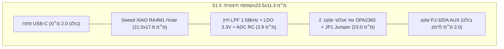

# מדריך תכנון פרמטרי ב-Fusion 360: קופסה זעירה ל-EarScope (`Seeed Studio XIAO RA4M1` — `Rev 2.0`)

מדריך זה מגדיר בתכנון משותף (Co-Design) את המידות של מעגל ה-PCB המיוצר ב-[`hardware_pcb/EarScope_XIAO_RA4M1/`](../hardware_pcb/EarScope_XIAO_RA4M1/) (ראו גם [`README.md`](../README.md)) ואת מארז ההדפסה בתלת-ממד עבור ארכיטקטורת **`Seeed Studio XIAO RA4M1`** (`SKU 102010551`) – תוך שימוש ישיר בשקע ה-**USB-C המובנה** שבולט מהקצה השמאלי של הלוח ובשקע ה-**AUX (`PJ-320A`)** בקצה הימני, וללא צורך בשום פתח צדדי למתג בזכות המעבר לג׳אמפר ההלחמה הפנימי **`JP1`**.

* **מידות ה-PCB הסופיות (`Edge.Cuts`):** **`48.0 × 20.0 × 1.6 mm`** (`960 mm²` – הקטנה של `29.4%` בשטח הלוח!)
* **מידות הקופסה החיצוניות הכוללות:** **`51.5 × 23.5 × 11.3 mm`** (`5.15 × 2.35 × 1.13 cm`)
* **שיטת הרכבה והדפסה:** שני חצאים (בסיס ומכסה) הננעלים ב-**Snap-Fit** ללא ברגים, מצמידים את הלוח בפינותיו הנקיות מרכיבים, אטומים מאבק בצדדים (אין חריץ למתג חיצוני), ומודפסים ב-**100% ללא תמיכות (Zero Supports)**.

---

## 1. עקרונות התכנון המכני (לפני שמתחילים ב-Fusion 360)

1. **הלחמה שטוחה (Castellated Flush Mount) של `Seeed Studio XIAO RA4M1` (`21.0 × 17.8 mm`):**
   מודול ה-XIAO RA4M1 מולחם שטוח לחלוטין על פני ה-PCB העליונים (`F.Cu`) דרך 14 פדי חצאי-חורים משוננים (`0 mm` הגבהה – ללא פיני Header!). מתחת ל-16 הפדים החשופים שבגחון ה-XIAO (`BAT+/BAT-`, `SWD`, `CAN`) הוגדר בלוח אזור `Keepout` נקי מנחושת ומ-Vias (`[0.95..16.90] × [4.00..16.10] mm`).
2. **שקע ה-USB-C המובנה (בולט `2.0 mm` שמאלה):**
   בקואורדינטות הלוח (`A1` ממורכז ב-`Y = 10.0 mm`, `X = 10.54 mm`), שקע ה-USB-C בולט **`2.0 mm` שמאלה מעבר לקו `X = 0.0 mm`** של ה-PCB הראשי – כך שהוא נכנס ישירות אל תוך דופן הקופסה השמאלית (`1.5 mm` עובי דופן + `0.25 mm` מרווח = `1.75 mm`) ומגיע כמעט עד קו הפנים החיצוני של המארז! הוספת מגרעת רדודה (`0.6 mm`) סביב הפתח מבטיחה חיבור מלא של כל כבל USB-C.
3. **שקע ה-AUX (`PJ-320A` 3.5mm TRRS) בקצה הימני (`X = 48.0 mm`, `Y = 8.8 mm`):**
   גוף השקע (`12.1 × 6.1 × 5.0 mm`) יושב בקצה הימני של הלוח כשהצווארון העגול שלו (`Ø5.0 mm`, אורך `2.0 mm`, מרכז בגובה **`2.5 mm` מעל הלוח**) בולט החוצה מ-`X = 48.0 mm` עד `X = 50.0 mm`. שימו לב שמרכז שקע ה-AUX ממוקם ב-`Y = 8.80 mm` (כלומר בהיסט צדי של **`1.20 mm`** מקו האמצע `Y = 10.0 mm` כדי להשאיר מרווח נוח לג׳אמפר ההלחמה `JP1` בדרום-מזרח הלוח).
4. **אפס פתחים צדדיים (החלפת מתג בג׳אמפר `JP1`):**
   בחירת מצב אוזנייה פסיבית (`OPEN = EAR`, ברירת מחדל) או מיקרופון אלקטרט (`BRIDGE = MIC`) מתבצעת על-ידי ג׳אמפר ההלחמה הפנימי `JP1` שעל הלוח, ולכן דפנות הצד של הקופסה חלקות ואטומות לחלוטין ללא צורך בחריץ למתג הזזה.

---

## 2. שלב 0: פתיחת פרויקט והזנת טבלת User Parameters

כל המודל ב-Fusion 360 מבוסס על פרמטרים ונוסחאות – שינוי מידה אחת בטבלה יעדכן אוטומטית את כל הגופים והפתחים.

1. פתח עיצוב חדש ב-Fusion 360 וודא ב-**Browser** משמאל ש-**Document Settings -> Units** מוגדר ל-`mm`.
2. שמור את הקובץ בשם `EarScope_XIAO_RA4M1_Enclosure`.
3. בתפריט העליון לחץ על **Modify -> Change Parameters** (או הקש `S` והקלד `Change Parameters`).
4. לחץ על **`+` (User Parameter)** והזן תחילה את הפרמטרים הקבועים ולאחריהם את הנוסחאות המחושבות:

### א. פרמטרים קבועים (ערכי בסיס)

| Name (שם ב-Fusion) | Unit | Expression (ערך) | תפקיד והסבר הנדסי |
| :--- | :---: | :---: | :--- |
| `pcb_l` | `mm` | `48.0` | אורך הלוח הכולל (`21.1mm` XIAO + `3.9mm` LPF/LDO + `23.0mm` AFE/AUX) |
| `pcb_w` | `mm` | `20.0` | רוחב הלוח (`17.8mm` רוחב ה-XIAO + מרווח לפדים משוננים) |
| `pcb_t` | `mm` | `1.6` | עובי PCB סטנדרטי ב-JLCPCB |
| `pcb_tol` | `mm` | `0.25` | מרווח חופש היקפי בין הלוח לדופן הקופסה |
| `wall` | `mm` | `1.5` | עובי דופן הקופסה (מותאם ל-3–4 קווי דופן בדיזה `0.4 mm`) |
| `bot_clear` | `mm` | `1.2` | גובה מדרגות התמיכה מתחת ללוח (מקום לפיני המיקום של שקע `PJ-320A`) |
| `top_clear` | `mm` | `5.5` | מרווח מעל הלוח (`5.0 mm` גובה שקע ה-AUX + `0.5 mm` מרווח ביטחון) |
| `usb_w` | `mm` | `9.5` | רוחב חלון שקע USB-C (`8.94 mm` תקני + טולרנס הדפסה) |
| `usb_h` | `mm` | `3.8` | גובה חלון שקע USB-C (`3.26 mm` תקני + טולרנס הדפסה) |
| `usb_center_h` | `mm` | `2.8` | גובה מרכז שקע ה-USB-C מעל פני ה-PCB הראשי (`~1.2mm` לוח XIAO + חצי שקע) |
| `usb_recess_d` | `mm` | `0.6` | עומק מגרעת חיצונית לראש פלסטיק של כבל USB-C |
| `aux_d` | `mm` | `5.4` | קוטר חור צווארון שקע ה-AUX (`5.0 mm` + `0.4 mm` טולרנס) |
| `aux_center_h` | `mm` | `2.5` | גובה מרכז חור ה-AUX מעל פני ה-PCB הראשי (`PJ-320A`) |
| `aux_y_offset` | `mm` | `1.2` | היסט אופקי של מרכז `J1` מקו האמצע של הלוח (`Y = 8.8 mm` במקום `10.0 mm`) |
| `ledge_e` | `mm` | `2.5` | גודל עמודי התמיכה וההידוק בפינות הימניות (`2.5 × 2.5 mm`) |
| `ledge_w_y` | `mm` | `0.55` | רוחב מסילת התמיכה בפינות השמאליות ליד ה-XIAO (תואם ל-Keepout `0.60 mm`) |
| `lip_h` | `mm` | `1.2` | גובה שפת הנעילה (Lip) בין הבסיס למכסה |
| `fit_tol` | `mm` | `0.15` | טולרנס התאמה בין חלקים מודפסים |

### ב. פרמטרים מחושבים (נוסחאות אוטומטיות)

| Name (שם ב-Fusion) | Unit | Expression (העתק בדיוק) | תוצאה נוכחית | משמעות |
| :--- | :---: | :--- | :---: | :--- |
| `inner_l` | `mm` | `pcb_l + 2 * pcb_tol` | `48.5 mm` | אורך חלל פנימי |
| `inner_w` | `mm` | `pcb_w + 2 * pcb_tol` | `20.5 mm` | רוחב חלל פנימי |
| `box_l` | `mm` | `inner_l + 2 * wall` | `51.5 mm` | אורך חיצוני כולל של הקופסה |
| `box_w` | `mm` | `inner_w + 2 * wall` | `23.5 mm` | רוחב חיצוני כולל של הקופסה |
| `box_h` | `mm` | `2 * wall + bot_clear + pcb_t + top_clear` | `11.3 mm` | גובה חיצוני כולל של הקופסה |
| `pcb_top_z` | `mm` | `wall + bot_clear + pcb_t` | `4.3 mm` | גובה פני הלוח העליונים מרצפת הקופסה החיצונית |
| `split_z` | `mm` | `pcb_top_z + aux_center_h` | `6.8 mm` | גובה מישור החיתוך בין הבסיס למכסה |

> [!TIP]
> **דיוק הנדסי במישור הפיצול (`split_z = 6.8 mm`):**
> מישור החיתוך בגובה `6.8 mm` חוצה את מעגל ה-AUX (`Ø5.4 mm`) **בדיוק בקו המשווה שלו**, ובמקביל חוצה את חלון ה-USB-C (`Z = 5.2 mm` עד `9.0 mm`) **בדיוק בחלק הישר והאנכי של הדפנות שלו** (ללא Undercut כלל!). לכן הלוח המולחם (כולל שקע ה-USB-C ושקע ה-AUX הבולטים ב-`2.0 mm` מכל צד) מתיישב ישר מלמעלה ב-90°, ושני חצאי הקופסה מודפסים ללא תמיכות.

---

## 3. שלב 1: בניית הגוף החלול של הקופסה

מיקום מרכז הקופסה בראשית הצירים (`Origin`) מאפשר שימוש ב-`Mirror` סימטרי.

1. לחץ על **Create Sketch** ובחר במישור התחתון (**XY Plane**).
2. בחר ב-**Create -> Rectangle -> Center Rectangle**, לחץ על ה-`Origin`, והזן:
   * ציר `X` (אורך): `box_l` (`51.5 mm`)
   * ציר `Y` (רוחב): `box_w` (`23.5 mm`)
3. בחר ב-**Modify -> Fillet** (בתוך הסקיצה), סמן את 4 הפינות של המלבן החיצוני והגדר רדיוס `2.5 mm`.
4. באותה סקיצה, צור **Center Rectangle** פנימי סביב ה-`Origin`:
   * אורך (`X`): `inner_l` (`48.5 mm`)
   * רוחב (`Y`): `inner_w` (`20.5 mm`)
   * הוסף ל-4 הפינות הפנימיות **Sketch Fillet** של `0.5 mm`.
5. לחץ **Finish Sketch**.
6. לחץ **Extrude (`E`)**, סמן את **שני השטחים יחד** (מסגרת + פנים) ליצירת בלוק מלא:
   * `Distance`: הזן `box_h` (`11.3 mm`)
   * `Operation`: `New Body` -> אשר (**OK**).
7. ב-**Browser** משמאל, פתח את **Sketches** והדלק את העין ליד **Sketch1**.
8. לחץ שוב **Extrude (`E`)** וסמן הפעם **רק את המלבן הפנימי**:
   * `Start`: שנה ל-**`Offset`** והזן `wall`
   * `Distance`: הזן `box_h - 2 * wall`
   * `Operation`: **`Cut`** -> אשר (**OK**), וכבה את העין של `Sketch1`.
9. בתיקיית **Bodies** שנה את שם הגוף ל-`Case_Main`.
10. הפעל תצוגת חתך לנוחות העבודה: **Inspect -> Section Analysis**, בחר במישור **XZ Plane** ואשר.

---

## 4. שלב 2: ייבוא מודל ה-`STEP` מ-KiCad (או מידול לוח ייחוס `PCB_Ref`)

ניתן לייבא ישירות את קובץ ה-3D המדויק מתוך KiCad (`EarScope_XIAO_RA4M1.kicad_pcb` -> `File -> Export -> STEP`), או למדל גוף ייחוס מהיר לבדיקת התאמה:

1. צור מישור עזר לגובה תחתית הלוח: **Construct -> Offset Plane** ממישור **XY Plane** במרחק `wall + bot_clear` -> אשר.
2. לחץ **Create Sketch** על המישור החדש, שרטט **Center Rectangle** בגודל `pcb_l` (`48.0 mm`) על `pcb_w` (`20.0 mm`), ובצע **Extrude (`New Body`)** לגובה `pcb_t` (`1.6 mm`) בשם `PCB_Ref`.
3. **מודול `Seeed Studio XIAO RA4M1` (צד שמאל `-X`):**
   * מלבן באורך `21.0 mm` ורוחב `17.8 mm` ממורכז על ציר `X` (`0.04 mm` מהקצה השמאלי), בגובה `1.2 mm` (`XIAO_Ref`), עם שקע USB-C (`8.94 × 7.3 × 3.26 mm`) הבולט **`2.0 mm` שמאלה** מעבר לקצה `PCB_Ref`.
4. **שקע ה-AUX `PJ-320A` (צד ימין `+X`):**
   * מלבן `12.1 × 6.1 × 5.0 mm` צמוד לקצה הימני של `PCB_Ref`, מוסט ב-`aux_y_offset` (`1.2 mm` לכיוון הצלע הצפונית `Y = 8.8 mm` בלוח), עם צווארון `Ø5.0 × 2.0 mm` בגובה `aux_center_h` (`2.5 mm`) מעל הלוח.

---

## 5. שלב 3: פתיחת חלון ה-USB-C וחור ה-AUX

כבה זמנית ב-Browser את גופי הייחוס כדי לחתוך רק את `Case_Main`.

### א. פתח USB-C ומגרעת ראש כבל (בדופן השמאלית, `-X`)
1. לחץ **Create Sketch** על **הפאה החיצונית השמאלית** של הקופסה.
2. שרטט **Center Rectangle** עבור פתח ה-USB-C הפנימי:
   * מרכז המלבן מיושר אנכית ל-`Origin` (`Y = 0` – שקע ה-USB-C של ה-XIAO ממורכז ב-`Y = 10.0 mm`).
   * גובה המרכז מתחתית הקופסה החיצונית: `pcb_top_z + usb_center_h` (`7.1 mm`).
   * רוחב: `usb_w` (`9.5 mm`), גובה: `usb_h` (`3.8 mm`), עם **Sketch Fillet** של `1.2 mm` ב-4 הפינות.
3. באותה סקיצה, שרטט **Center Rectangle** חיצוני בגודל `12.4 × 6.2 mm` (Fillet של `2.0 mm`) עבור מגרעת פלסטיק הכבל -> **Finish Sketch**.
4. בצע **Extrude (`Cut`)** למלבן הפנימי לעומק `-wall - 0.5 mm`, ולטבעת החיצונית לעומק `-usb_recess_d` (`-0.6 mm`).

### ב. פתח AUX (בדופן הימנית, `+X`)
1. לחץ **Create Sketch** על **הפאה החיצונית הימנית** של הקופסה.
2. שרטט **Center Diameter Circle** בקוטר `aux_d` (`5.4 mm`):
   * גובה המרכז מתחתית הקופסה החיצונית: `split_z` (`6.8 mm`).
   * מיקום אופקי (`Y`): מוסט ב-**`aux_y_offset` (`1.2 mm`)** ממרכז הדופן לכיוון הצלע הצפונית של הלוח (בהתאם למיקום `J1` ב-`Y = 8.80 mm` בקובץ `EarScope_XIAO_RA4M1.kicad_pcb`).
3. בצע **Extrude (`Cut`)** פנימה לעומק `-wall - 0.5 mm` והוסף **Chamfer** חיצוני של `0.4 mm`.

---

## 6. שלב 4: פיצול הקופסה, עמודי הצמדה ונעילת Snap-Fit

1. **פיצול לבסיס ומכסה (`Split Body`):**
   * צור **Offset Plane** ממישור **XY Plane** בגובה `split_z` (`6.8 mm`) ופצל את `Case_Main` ל-`Bottom_Case` ול-`Top_Lid`.
2. **מדרגות תמיכה והצמדה ב-4 הפינות:**
   * **מתחת ללוח (`Bottom_Case`):** מכיוון שגבו התחתון של הלוח (`B.Cu`) שטוח לחלוטין (משטח `GND` רציף ללא רכיבים תחתונים), מדרגות תמיכה בגובה `bot_clear` (`1.2 mm`) ב-4 הפינות (`2.5 × 2.5 mm`) תומכות בלוח ביציבות מלאה.
   * **מעל הלוח (`Top_Lid`):** ב-2 הפינות הימניות צור עמודי הצמדה בגודל `ledge_e` (`2.5 × 2.5 mm`), וב-2 הפינות השמאליות (לצד מודול ה-XIAO RA4M1) צור שפתי הצמדה צרות ברוחב `ledge_w_y` (`0.55 mm` בציר `Y` × `2.5 mm` בציר `X`) התואמות בדיוק לאזורי ה-Keepout השמאליים (`0..0.60 mm` ו-`19.40..20.0 mm`) שעל ה-PCB!
3. **נעילת Snap-Fit צידית (ללא תמיכות):**
   * על מישור **YZ Plane** בגובה `split_z`, צור שן נעילה בגובה `lip_h` (`1.2 mm`) עם בליטת קליק קטנה של `0.25 mm` בשיפוע `45°` לאורך `28 mm` במרכז דפנות האורך של `Bottom_Case`, החסר אותה מ-`Top_Lid` באמצעות **Combine (`Cut`, `Keep Tools`)**, והוסף `Offset Face` של `-fit_tol` (`-0.15 mm`).

---

## 7. שלב 5: גימור וייצוא להדפסת תלת-ממד (`3MF` / `STL`)

1. הוסף **Chamfer** חיצוני של `0.8 mm` לשפה העליונה של `Top_Lid` ולשפה התחתונה של `Bottom_Case`.
2. ייצא בנפרד את `Bottom_Case` ואת `Top_Lid` כקובצי **`3MF`**.
3. **הגדרות הדפסה מומלצות ב-Slicer:** הנח את `Bottom_Case` על רצפתו ואת `Top_Lid` הפוך ב-`180°` על גגו; גובה שכבה `0.16 mm`, `3–4 Walls`, **`Supports: Off`**, חומר `PETG` או `PLA+`.
   * *טיפ הרכבה:* אם תרצה בעתיד לעבור מאוזנייה פסיבית למיקרופון אלקטרט (או להפך), פתח את מכסה ה-Snap-Fit בשנייה אחת וגשר/נקה בטיפת בדיל את ג׳אמפר **`JP1`** שעל הלוח.
