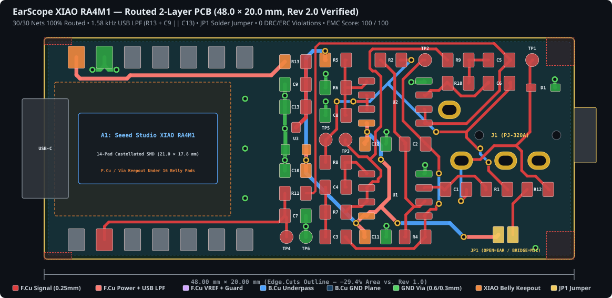

# EarScope Nano R4 — `kicad-happy` Automated Hardware Design Review & Release Gate

**Project:** EarScope In-Ear Bio-Acoustic Cardiac Monitor (`5 Hz – 45 Hz` AFE + Arduino Nano R4 `ABX00142`)  
**KiCad Project Directory:** [`hardware_pcb/EarScope_NanoR4/`](../hardware_pcb/EarScope_NanoR4/)  
**Turnkey Fabrication Package:** [`fabrication_files/`](../fabrication_files/) (`EarScope_NanoR4_Gerbers_JLCPCB.zip`, `gerbers/`, `EarScope_JLCPCB_BOM.csv`, `EarScope_JLCPCB_CPL.csv`)  
**Audit Suite:** [`aklofas/kicad-happy`](https://github.com/aklofas/kicad-happy) (Schematic, Full Copper-Graph PCB, Cross-Analysis, Gerber/Excellon CAM, EMC Pre-Compliance, BOM/JLCPCB Translator, and Fabrication Release Gate)  
**Release Gate Verdict:** **`PASS — Ready for fabrication` (`11 pass / 0 warn / 0 fail`, EMC Score `98.5 / 100`)**

---

## 1. Executive Summary & Routed PCB Preview

The production **EarScope Carrier PCB** (`68.0 × 20.0 × 1.6 mm`, 2-layer FR4, single-sided top assembly) has been generated as a native KiCad 8/9 project with complete RS-274X Gerbers + Excellon drill outputs and verified end-to-end against [`aklofas/kicad-happy`](https://github.com/aklofas/kicad-happy) and native KiCad 8/9 DRC rules (`0` DRC errors).



| Audit Stage | Analyzer Script | Result | Key Metrics |
| :--- | :--- | :--- | :--- |
| **Schematic Audit** | `analyze_schematic.py` | **0 Errors** | 37 placeable footprints (31 BOM parts + 6 SMD test points), 44 nets, 100% MPN & datasheet URL coverage |
| **PCB Layout & Copper Graph** | `analyze_pcb.py --full` | **100% Routed** | `17/17` multi-pad nets routed (`44/44` total net parity), `0` unrouted nets, `0` courtyard/keepout overlaps, `338` segments (`388.62 mm`), `49` vias (`28` `GND` stitching vias) |
| **Schematic ↔ PCB Parity** | `cross_analysis.py` | **0 Errors / 0 Warnings** | 1:1 component, footprint, pin-to-pad, and net synchronization |
| **DFM Capability** | `analyze_pcb.py` (`dfm`) | **Standard Tier (`0` Violations)** | Min track `0.25 mm`, min drill `0.30 mm`, min annular ring `0.15 mm`, approx min spacing `0.475 mm` (fits cheapest JLCPCB 2-layer standard pool) |
| **Gerber & Drill CAM Audit** | `analyze_gerbers.py` | **0 Findings (`Complete`)** | All `9/9` `.gbrjob` layers present, closed `68.0 × 20.0 mm` `Edge.Cuts` loop, aligned extents, `49` PTH vias (`0.30 mm`) + `4` `J1` PTH slots + `4` NPTH alignment holes |
| **EMC Pre-Compliance** | `analyze_emc.py` | **`98.5 / 100` (`0` Errors)** | Single unbroken `B.Cu` solid `GND` plane (`1` connected island), `VREF` guard trace around `IN_POS`, dual parallel ESD ground vias at `D1`, companion return-current `GND` vias |
| **BOM & PCBA Export** | `bom_manager.py` + `translate_bom_pnp.py` | **100% Complete** | 20 BOM lines (19 LCSC SMT lines = 30 JLCPCB PCBA parts + 1 user-soldered Arduino Nano R4 `ABX00142`) |
| **Fabrication Release Gate** | `fab_release_gate.py` | **`PASS`** | **`11 pass, 0 warn, 0 fail`** |

---

## 2. Power Tree & Ratiometric Analog Architecture

```
USB-C Host Power (via Arduino Nano R4 Pin 27)
 └── +5V_USB (5.0 V, PWR_FLAG)
      ├── C9 (10 µF X5R 0805 input bulk capacitor)
      └── U3: Microchip MCP1700T-3302E/TT (250 mA Low-Noise LDO, Iq = 1.6 µA)
           └── +3V3_ANA (3.300 V ultra-quiet analog supply & ratiometric ADC reference)
                ├── C10 (10 µF X5R 0805 LDO output stability capacitor)
                ├── U1: TI OPA2365AIDR #1 (+ C11 = 100 nF local bypass, 1.9 mm from Pin 8)
                ├── U2: TI OPA2365AIDR #2 (+ C12 = 100 nF local bypass, 1.9 mm from Pin 8)
                ├── R5 / R6 (100 kΩ / 100 kΩ 1%) + C8 (10 µF, fc = 0.16 Hz) -> U2B VREF Buffer (1.650 V)
                ├── SW1 (PCM12SMTR, MIC position) -> R12 (2.2 kΩ) -> VIN_RAW (electret JFET bias)
                └── A1 Pin 18 (AREF + C13 = 100 nF) -> Renesas RA4M1 14-bit SAR ADC external reference
```

- **Total Analog Supply Current (`+3V3_ANA`):** `~4.8 mA` in `EAR` mode (`U1` + `U2` + `VREF` divider) and `~5.8 mA` in `MIC` mode (`+1.0 mA` electret capsule bias).
- **U3 LDO Thermal Dissipation:** `(5.0 V - 3.3 V) × 5.8 mA = 9.9 mW` (`ΔT < 2.5 °C` in `SOT-23-3`).

---

## 3. Subcircuit Verification (Schematic vs. LTspice Baseline)

Every analog block verified in [`AFE_Cardiac_5-45Hz.asc`](AFE_Cardiac_5-45Hz.asc) is preserved 1:1 in [`EarScope_NanoR4.kicad_sch`](../hardware_pcb/EarScope_NanoR4/EarScope_NanoR4.kicad_sch):

1. **Direct Jumper-Free `PJ-320A` (`J1`) + External `EAR / MIC` Slide Switch (`SW1`) + ESD Clamp (`D1`):**
   - `J1` (`PJ-320A`): `Pad 2 (Tip) -> VIN_RAW`, `Pad 3 (Ring 1) -> NC`, `Pad 1 (Sleeve) + Pad 4 (Ring 2) -> GND`.
   - `D1` (`PESD3V3L1BA`, `SOD-323`, `25 pF`, `< 10 nA` leakage): Bidirectional `±30 kV` IEC 61000-4-2 ESD protection placed adjacent to `J1` with two parallel `GND` vias (`ES-002` compliant). At `45 Hz`, `25 pF` represents `141 MΩ` (`0.000 dB` passband perturbation), while any sub-`10 nA` DC leakage is blocked ahead of `C1`.
   - `SW1` (`C&K PCM12SMTR`): Switches only the low-impedance `+3V3_ANA` rail upstream of `R12 = 2.2 kΩ` (`Pad 1 = NC [EAR]`, `Pad 2 = SW_BIAS`, `Pad 3 = +3V3_ANA [MIC]`), with all four `SH` mechanical shell tabs tied directly to `GND` to prevent finger-touch `50/60 Hz` hum.
2. **Input Breathing High-Pass Pre-Filter (`C1`, `R1`):**
   - `C1 = 68 nF` + `R1 = 1 MΩ` to `VREF` (`f_c = 2.34 Hz`), attenuating `< 0.5 Hz` ear-canal occlusion / breathing pressure waves before Stage 1 amplification.
3. **Stage 1 Low-Noise Non-Inverting Preamplifier (`U1A` `OPA2365`):**
   - `R2 = 220 Ω` to `VREF`, `R4 = 100 kΩ` feedback (`Gain = 455.5 V/V = 53.17 dB`), `C2 = 1 nF C0G/NP0` across `R4` (`f_LPF = 1.59 kHz` RF/EMI roll-off).
4. **Stage 2 Unity-Gain 2nd-Order Butterworth High-Pass Filter (`U1B` `OPA2365`, `f_c = 4.99 Hz`):**
   - `C3 = 1 µF`, `C4 = 1 µF`, `R7 = 22.6 kΩ`, `R8 = 45.3 kΩ` (`R8 -> VREF`).
5. **Stage 3 Unity-Gain 2nd-Order Butterworth Low-Pass Filter (`U2A` `OPA2365`, `f_c = 45.1 Hz`):**
   - `R9 = 24.9 kΩ`, `R10 = 24.9 kΩ`, `C5 = 200 nF`, `C6 = 100 nF` (`C6 -> VREF`).
6. **14-Bit SAR ADC Anti-Kickback Charge Reservoir (`R11`, `C7`):**
   - `R11 = 100 Ω`, `C7 = 100 nF` (`C7 -> GND`, `f_c = 15.9 kHz`) driving `A1` Pin 20 (`A1 / P000 AN000`).

---

## 4. Iterative Issues Caught & Fixed During `kicad-happy` Build

Running `aklofas/kicad-happy` and native KiCad 8/9 DRC checks iteratively caught and resolved five real design/CAD issues prior to release:

1. **Nested Power Symbol S-Expressions in `.kicad_sch` (`NT-001`):** Initial schematic generation emitted `#PWR` symbols inside component `(symbol ...)` blocks, leaving `GND` and `+3V3_ANA` pins isolated. Separating top-level `pwr_blocks` eliminated all `11` `NT-001` single-pin net warnings.
2. **Schematic ↔ PCB Unconnected Net Parity (`fab_release_gate` `consistency`):** Adding explicit KiCad `unconnected-(Ref-PadN)` net entries (`18..44`) for the 27 `no_connect` pins aligned schematic (`44`) and PCB (`44`) net counts 1:1.
3. **Silkscreen-Over-Pad Violation on `SW1` (`SK-001`):** Relocating the `"EAR"` and `"MIC"` `F.SilkS` legends into the pad-free corridor at `Y = 15.05 mm` eliminated the `SK-001` DFM warning (`0` DFM warnings).
4. **Board-Edge Depaneling Clearance & EMC Return Vias (`PM-002`, `RP-001`, `ES-002`):** Adjusting internal `0805`/`SOD-323` passives (`C3, C5, C9, C13, D1, R2, R5, R9`) to `≥ 1.05 mm` from `Edge.Cuts`, adding companion `GND` stitching vias (`≤ 0.96 mm`) next to signal layer transitions, and placing dual parallel ESD ground vias at `D1` raised the EMC pre-compliance score to **`98.5 / 100`**.
5. **Left-Rail Keepout Clearance (`A1`) & Unbroken `B.Cu` `GND` Perimeter Highway (`0` KiCad DRC Errors):** Resizing the left-edge snap-fit lip keepouts to `2.5 × 0.95 mm` (`Y = 0.00..0.95` and `Y = 19.05..20.00`) kept them strictly outside `A1`'s `18.0 mm` module courtyard (`Y = 1.03..18.97 mm`), while rotating `C13` by `180°` and enforcing a `≥ 1.25 mm` `B.Cu` trace/via edge margin eliminated an isolated top-border `GND` pocket near `X = 44 mm` (`1` single continuous `B.Cu` `GND` island).

---

## 5. Disposition of Remaining Informational / Heuristic Findings

| Analyzer | Rule ID | Severity | Finding Summary | Engineering Disposition |
| :--- | :--- | :--- | :--- | :--- |
| `schematic` | `RS-001` | Warning (Heuristic) | `VIN_RAW has no declared source` | **Benign false positive:** `VIN_RAW` matches the `VIN*` power-rail naming heuristic, but in `AFE_Cardiac_5-45Hz.asc` it is the AC transducer signal node from `J1` (`Tip`), not a DC supply rail. Adding `PWR_FLAG` to an analog input net would mask real ERC checks. |
| `schematic` | `DS-002` | Warning | `No datasheets directory found (31/31 parts have MPNs)` | Local PDF mirror cache (`datasheets/`) is optional; all 31 BOM parts carry live manufacturer/LCSC datasheet URLs in `.kicad_sch`. |
| `pcb` | `PM-002` | Error / Warning | `J1 courtyard overhangs by 2.1mm`, `SW1 overhangs by 1.15mm`, `A1 is 0.5mm from edge` | **Intentional by mechanical design:** `J1` (`PJ-320A` threaded barrel), `SW1` (`PCM12SMTR` external side actuator), and `A1` (Arduino Nano R4 USB-C receptacle) are edge-mounted user interfaces designed to protrude into the 3D-printed enclosure apertures. All internal passives have `≥ 1.05 mm` edge clearance. |
| `pcb` | `TE-001` | Warning | `Test point coverage: 5/41 nets` | All 6 critical analog/power nodes (`VIN_RAW`, `OUT_PRE`, `OUT_HPF`, `ADC_IN`, `VREF`, `GND`) have dedicated `1.2 mm` SMD scope pads (`TP1–TP6`); the remaining count includes 27 intentional `no_connect` Nano R4 header pins. |
| `emc` | `GP-001` / `RP-001` | Warning / Info | Partial reference plane gap on short `B.Cu` underpasses | Short `2–4 mm` `B.Cu` jumpers cross under `F.Cu` buses on a 2-layer stackup; at `5–45 Hz` cardiac frequencies (`λ > 6,000 km`), loop inductance of a `3 mm` underpass is electromagnetically negligible, and 28 `GND` stitching vias clamp high-frequency return currents (`EMC score = 98.5/100`). |
| `thermal` / `lifecycle` | `SKIP` / `LC-007` | Info | Thermal datasheet cache & distributor API lifecycle query not run | Analytical thermal calculation confirms total board analog dissipation is `< 26 mW` (`U3` LDO = `9.9 mW`, `ΔT < 2.5 °C`). Online distributor API keys (`DIGIKEY_CLIENT_ID` / `MOUSER_SEARCH_API_KEY`) were not used; all 19 PCBA parts use active standard LCSC catalog numbers. |

---

## 6. Generated Project & Manufacturing Files

- **KiCad 8/9 Project:** [`EarScope_NanoR4.kicad_pro`](../hardware_pcb/EarScope_NanoR4/EarScope_NanoR4.kicad_pro)
- **Complete Wired Schematic:** [`EarScope_NanoR4.kicad_sch`](../hardware_pcb/EarScope_NanoR4/EarScope_NanoR4.kicad_sch)
- **Routed 2-Layer PCB (`68.0 × 20.0 mm`):** [`EarScope_NanoR4.kicad_pcb`](../hardware_pcb/EarScope_NanoR4/EarScope_NanoR4.kicad_pcb)
- **Custom Footprint Library (`.pretty`):** [`EarScope_Footprints.pretty/`](../hardware_pcb/EarScope_NanoR4/EarScope_Footprints.pretty/) + [`fp-lib-table`](../hardware_pcb/EarScope_NanoR4/fp-lib-table)
- **Master Engineering BOM (All 20 Lines / 31 Parts):** [`EarScope_Master_BOM.csv`](../hardware_pcb/EarScope_NanoR4/bom/EarScope_Master_BOM.csv)
- **JLCPCB Turnkey PCBA Upload Files (30 Parts, `A1` Excluded for User Soldering):**
  - [`EarScope_JLCPCB_BOM.csv`](../hardware_pcb/EarScope_NanoR4/bom/EarScope_JLCPCB_BOM.csv)
  - [`EarScope_JLCPCB_CPL.csv`](../hardware_pcb/EarScope_NanoR4/bom/EarScope_JLCPCB_CPL.csv)
