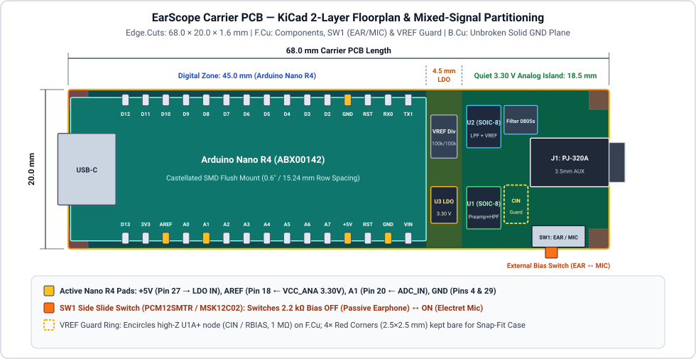

# KiCad 8 / 9 Schematic & PCB Design Guide (Arduino Nano R4 Edition)

This guide provides a complete, step-by-step workflow to translate the validated LTspice schematic ([`AFE_Cardiac_5-45Hz.asc`](AFE_Cardiac_5-45Hz.asc)) into a production-ready **2-layer Mixed-Signal Carrier PCB** in **KiCad 8 / KiCad 9**, ready for fabrication at **JLCPCB** or **PCBWay** and mechanical integration in **Fusion 360**.

---

## 1. Board Architecture & Manufacturing Specifications

To achieve sub-microvolt analog noise immunity (`0.141 µVrms` across `5–45 Hz`) without paying for a 4-layer stackup, the carrier board uses a **co-planar 2-layer architecture** with strict physical separation between the `48 MHz` **Arduino Nano R4** digital domain and the `3.30 V` **OPA2365** analog island:

* **Board Dimensions (`Edge.Cuts`):** **`68.0 mm × 20.0 mm`**, `1.6 mm` standard FR-4 thickness (`1 oz` / `35 µm` copper).
* **Layer Stackup:**
  * **`F.Cu` (Top Layer):** All SMD components, Arduino Nano R4 castellated flush mount, short analog signal traces, and a `VREF` active guard ring around the high-impedance preamp input.
  * **`B.Cu` (Bottom Layer):** **100% continuous, unbroken `GND` copper pour** acting as an electromagnetic shield underneath both the AFE and the Nano R4.
* **Assembly Style:** Single-sided top assembly (`0805` passives, `SOIC-8` op-amps, `SOT-23-3` LDO, SMD `PJ-320A` jack, and headerless castellated **Arduino Nano R4 `ABX00142`**) — easy to hand-solder or order via turnkey PCBA.

---

## 2. Step 1 — KiCad Project Creation & Design Rules (`Board Setup`)

1. Open KiCad (`8.0+` or `9.0+`) $\rightarrow$ **File $\rightarrow$ New Project** $\rightarrow$ save inside `hardware_pcb/EarScope_NanoR4`.
2. Open the PCB Editor (**`Pcbnew`**) $\rightarrow$ **File $\rightarrow$ Board Setup** and enter these fabrication-safe constraints (compatible with standard `$2` 2-layer rules at JLCPCB and PCBWay):

| Parameter (`Design Rules -> Constraints`) | Recommended Setting | Notes |
| :--- | :--- | :--- |
| **Copper Layers** | `2` (`F.Cu`, `B.Cu`) | `1.6 mm` finished board thickness |
| **Minimum Clearance** | **`0.20 mm`** (`8 mil`) | Generous margin over `0.127 mm` (`5 mil`) fab limit |
| **Minimum Track Width** | **`0.20 mm`** (`8 mil`) | Safe yield across all fabs |
| **Minimum Via Size / Drill** | **`0.60 mm` diameter / `0.30 mm` drill** | Standard cost-free via size |
| **Copper to Edge Clearance** | **`0.30 mm`** | Prevents exposed copper during V-cut / routing |

3. Under **Board Setup $\rightarrow$ Design Rules $\rightarrow$ Net Classes**, create three net classes:

| Net Class | Track Width | Clearance | Assigned Nets |
| :--- | :---: | :---: | :--- |
| **`Default` (Analog Signal)** | `0.25 mm` | `0.20 mm` | `VIN_RAW`, `OUT_PRE`, `HPF_MID`, `OUT_HPF`, `LPF_MID`, `OUT_LPF`, `ADC_IN` |
| **`HighZ_Input`** | `0.25 mm` | **`0.35 mm`** | `IN_POS` (between `CIN`, `RBIAS`, and `U1` Pin 3) |
| **`Power`** | **`0.50 mm`** | `0.25 mm` | `+5V_USB`, `VCC_ANA`, `VREF`, `GND` |

---

## 3. Step 2 — LTspice-to-KiCad Component, Symbol & Footprint Mapping

Every component below maps 1-to-1 to [`docs/AFE_Cardiac_5-45Hz.asc`](AFE_Cardiac_5-45Hz.asc). All symbols and footprints (except `PJ-320A`, noted below) ship **built-in** with KiCad 8/9:

| LTspice Name | KiCad Ref | Value / Part Number | Built-In KiCad Symbol | Built-In KiCad Footprint | LCSC Part # (Ref) |
| :--- | :---: | :--- | :--- | :--- | :---: |
| `MCU` | **`A1`** | `Arduino Nano R4` (`ABX00142`) | `MCU_Module:Arduino_Nano_Every` *(or `Arduino_Nano_v3.x`)* | Custom Castellated copy of `Module:Arduino_Nano` *(Sec. 4.1)* | Official Arduino |
| `U1` (`U1A, U1B`) | **`U1`** | `OPA2365AIDR` | `Amplifier_Operational:OPA2365xD` *(or `LM358`)* | `Package_SO:SOIC-8_3.9x4.9mm_P1.27mm` | `C78566` |
| `U2` (`U2A, U2B`) | **`U2`** | `OPA2365AIDR` | `Amplifier_Operational:OPA2365xD` *(or `LM358`)* | `Package_SO:SOIC-8_3.9x4.9mm_P1.27mm` | `C78566` |
| `VSUP` (LDO) | **`U3`** | `MCP1700T-3302E/TT` | `Regulator_Linear:MCP1700x-3302xx_SOT23` | `Package_TO_SOT_SMD:SOT-23` | `C39051` |
| `VEAR` (Jack) | **`J1`** | `PJ-320A` (3.5mm TRRS) | `Connector_Audio:AudioJack4` | `PJ-320A` SMD 4-pad *(import from EasyEDA/LCSC `C95555`)* | `C95555` |
| `CIN` | **`C1`** | `68 nF` (`C0G/NP0` or `X7R`, `≥25V`) | `Device:C` | `Capacitor_SMD:C_0805_2012Metric` | `C1589` / `C0G` |
| `C1` (`CF` in doc) | **`C2`** | `1 nF` (`C0G/NP0`, `50V`) | `Device:C` | `Capacitor_SMD:C_0805_2012Metric` | `C1706` |
| `C1H, C2H` | **`C3, C4`** | `1 µF` (`X7R`, `≥16V`) | `Device:C` | `Capacitor_SMD:C_0805_2012Metric` | `C28323` |
| `CAL` | **`C5`** | `200 nF` *(or two parallel `100 nF`)* | `Device:C` | `Capacitor_SMD:C_0805_2012Metric` | `C53438` |
| `CBL` | **`C6`** | `100 nF` (`C0G` or `X7R` $\rightarrow$ **`VREF`**) | `Device:C` | `Capacitor_SMD:C_0805_2012Metric` | `C49678` |
| `COUT` | **`C7`** | `100 nF` (`C0G` or `X7R` $\rightarrow$ **`GND`**) | `Device:C` | `Capacitor_SMD:C_0805_2012Metric` | `C49678` |
| `CREF` | **`C8`** | `10 µF` (`X7R`, `≥10V` on `U2B+`) | `Device:C` | `Capacitor_SMD:C_0805_2012Metric` | `C15850` |
| `CLDO_IN, CLDO_OUT` | **`C9, C10`** | `10 µF` (`X7R`, `≥10V`) | `Device:C` | `Capacitor_SMD:C_0805_2012Metric` | `C15850` |
| `CDEC1, CDEC2, CAREF` | **`C11–C13`** | `100 nF` (`X7R`, `50V` bypass) | `Device:C` | `Capacitor_SMD:C_0805_2012Metric` | `C49678` |
| `RBIAS` | **`R1`** | `1 MΩ` (`1%`) | `Device:R` | `Resistor_SMD:R_0805_2012Metric` | `C17514` |
| `RG` | **`R2`** | `220 Ω` (`1%`, selected gain) | `Device:R` | `Resistor_SMD:R_0805_2012Metric` | `C17557` |
| `RG_ALT` *(opt.)* | **`R3`** | `DNP` (`1 kΩ` / `100 Ω` parallel option) | `Device:R` | `Resistor_SMD:R_0805_2012Metric` | — |
| `RF, RREF1, RREF2` | **`R4, R5, R6`** | `100 kΩ` (`1%` Thin Film) | `Device:R` | `Resistor_SMD:R_0805_2012Metric` | `C17407` |
| `RAH` | **`R7`** | `22.6 kΩ` (`1%`) | `Device:R` | `Resistor_SMD:R_0805_2012Metric` | `C137927` |
| `RBH` | **`R8`** | `45.3 kΩ` (`1%`) | `Device:R` | `Resistor_SMD:R_0805_2012Metric` | `C138044` |
| `R1L, R2L` | **`R9, R10`** | `24.9 kΩ` (`1%`) | `Device:R` | `Resistor_SMD:R_0805_2012Metric` | `C25962` |
| `ROUT` | **`R11`** | `100 Ω` (`1%`) | `Device:R` | `Resistor_SMD:R_0805_2012Metric` | `C17408` |
| `RMIC` | **`R12`** | `2.2 kΩ` (`1%`, electret bias) | `Device:R` | `Resistor_SMD:R_0805_2012Metric` | `C17520` |
| Bias / Jack Jumpers | **`JP1–JP3`** | Flat SMD Solder Jumpers | `Jumper:SolderJumper_2_Open` / `_Bridged` | `Jumper:SolderJumper-2_P1.3mm_Open_RoundedPad1.0x1.5mm` | Copper Only |
| Scope Test Pads | **`TP1–TP6`** | `1.2 mm` Flat SMD Test Points | `Connector:TestPoint` | `TestPoint:TestPoint_Pad_D1.2mm` | Copper Only |

---

## 4. Step 3 — Critical Pinouts & Custom Footprint Details (Must Verify!)

### 4.1 Converting `Module:Arduino_Nano` to a Flush Castellated SMD Footprint
The **Arduino Nano R4 (`ABX00142`)** has a flat underside and castellated half-holes along both `15-pin` edges (`2.54 mm` pitch, `15.24 mm` row-to-row spacing). Modifying KiCad's standard footprint takes under 60 seconds and eliminates `~8.5 mm` of vertical header height while keeping your bottom `GND` plane `100%` unperforated:

1. Open **Footprint Editor** $\rightarrow$ search `Module:Arduino_Nano` $\rightarrow$ **File $\rightarrow$ Save Copy As** into a project library (`EarScope_Footprints.pretty`) named `Arduino_Nano_R4_Castellated_SMD`.
2. Delete the 4 corner mounting holes (if present in the template) so the footprint fits cleanly within `45.0 × 18.0 mm`.
3. Select **all 30 numbered pads (`1` through `30`)** $\rightarrow$ press **`E`** (Properties):
   * **Pad Type:** Change from `Through-hole` to **`SMD`**.
   * **Pad Shape:** `Rounded Rectangle` (`Corner radius = 25%`).
   * **Pad Size:** **`1.50 mm` (along `2.54 mm` pitch) × `2.80 mm` (across edge)** so `~0.9 mm` of copper extends *outward* past the `18.0 mm` Nano R4 edge for effortless hand soldering of the castellated half-moons.
   * **Copper / Mask Layers:** Ensure `F.Cu`, `F.Paste`, and `F.Mask` are checked (`B.Cu` unchecked).
4. **Nano R4 Pin Connections (verify by pin number AND signal name):**

| KiCad Nano Pin # | Nano R4 Pad Name | `RA4M1` MCU Pin | Carrier PCB Net | Electrical Role |
| :---: | :---: | :--- | :--- | :--- |
| **Pin 27** | **`+5V`** | `VUSB` (after `D1`) | **`+5V_USB`** | Input power to `U3` (`MCP1700-3.3V` LDO Pin 3) + `C9` (`10 µF`) |
| **Pin 18** | **`AREF`** | `P010 / VREFH0` | **`VCC_ANA`** | External `3.300 V` 14-bit ADC reference + `C13` (`100 nF` to `GND`) |
| **Pin 20** | **`A1`** | `P000 / AN000` | **`ADC_IN`** | Dedicated 14-bit SAR ADC input (avoids `A0` DAC & `A4/A5` I2C) |
| **Pins 4 & 29** | **`GND`** | `VSS / AVSS0` | **`GND`** | Bond **both** `GND` pads directly to `B.Cu` ground plane via vias |
| *All other pins* | `D0–D13, A0, A2–A7, 3V3, VIN, RST` | — | *Unconnected* | Place KiCad **No-Connect (`X`)** flags in `Eeschema` |

---

### 4.2 `OPA2365AIDR` (`U1`, `U2` — `SOIC-8`) Multi-Unit Pinout

> [!IMPORTANT]
> In KiCad `Eeschema`, dual op-amp symbols have **three units**: **Unit A** (Amplifier 1), **Unit B** (Amplifier 2), and **Unit C** (Power Pins `4` and `8`). **Do not forget to place `U1C` and `U2C`** on your schematic sheet, or your op-amps will have floating power pins on the PCB!

| `SOIC-8` Pin | Function | **`U1` (`OPA2365AIDR`) Net** | **`U2` (`OPA2365AIDR`) Net** |
| :---: | :---: | :--- | :--- |
| **1** | `OUT A` | `OUT_PRE` (Stage 1 Preamp Output) | `OUT_LPF` (Stage 3 `45 Hz` LPF Output $\rightarrow$ `R11`) |
| **2** | `-IN A` | Preamp Feedback (`R2=220Ω`, `R4=100kΩ`, `C2=1nF`) | Tied directly to **Pin 1 (`OUT_LPF`)** |
| **3** | `+IN A` | **`IN_POS`** (`C1=68nF` & `R1=1MΩ` — *Guard Ring!*) | From `R10` (`24.9kΩ`) & `C6` (`100nF` to `VREF`) |
| **4** | **`V-`** | **`GND`** | **`GND`** |
| **5** | `+IN B` | From `C4` (`1µF`) & `R8` (`45.3kΩ` to `VREF`) | **`VREF_DIV`** (`R5=100k`, `R6=100k`, `C8=10µF`) |
| **6** | `-IN B` | Tied directly to **Pin 7 (`OUT_HPF`)** | Tied directly to **Pin 7 (`VREF`)** |
| **7** | `OUT B` | `OUT_HPF` (Stage 2 `5 Hz` HPF Output $\rightarrow$ `R9`) | **`VREF`** (`1.650 V` Buffered Virtual Ground) |
| **8** | **`V+`** | **`VCC_ANA`** (`+3.30 V`, decouple `<2mm` with `C11`) | **`VCC_ANA`** (`+3.30 V`, decouple `<2mm` with `C12`) |

---

### 4.3 `MCP1700T-3302E/TT` (`U3` — `SOT-23-3`) Pinout Check

> [!WARNING]
> **Double-check `SOT-23-3` regulator pin numbering!** Different LDO families swap `GND`, `VIN`, and `VOUT`. For Microchip **`MCP1700T-3302E/TT`** (`Package_TO_SOT_SMD:SOT-23`):
> * **Pin 1:** **`GND`**
> * **Pin 2:** **`VOUT`** (`VCC_ANA = +3.300 V` $\rightarrow$ `C10 = 10 µF` to `GND`)
> * **Pin 3:** **`VIN`** (`+5V_USB` from Nano R4 Pin 27 $\rightarrow$ `C9 = 10 µF` to `GND`)

---

### 4.4 Universal `PJ-320A` (`J1`) TRRS Wiring (Supports Both 3-Pole TRS & 4-Pole CTIA Headsets!)

A common pitfall with `3.5 mm` TRRS jacks (`PJ-320A`) is that **4-pole smartphone headsets (CTIA standard)** place `GND` on **Ring 2** and the inline microphone on **Sleeve**, whereas **3-pole TRS earphones** have a long ground sleeve bridging **Ring 2 + Sleeve**:

* If you tie *only* `Sleeve` to `GND` and leave `Ring 2` floating, **plugging in 4-pole TRRS earbuds leaves the Left Speaker return completely open-circuit!**
* Wire `J1` (`PJ-320A`) with three tiny zero-height SMD solder jumpers so the board supports **every** 3.5 mm transducer out of the box:
  1. **`Ring 2` contact** $\rightarrow$ Connect **permanently to `GND`** (works as `GND` for *both* 3-pole TRS earphones and 4-pole CTIA headsets!).
  2. **`JP2` (`SolderJumper_2_Bridged` from `Sleeve` to `GND`):**
     * **Default (Bridged):** Ties `Sleeve` + `Ring 2` solidly to `GND` for passive earphone mode.
     * **Cut Open:** Frees `Sleeve` when using a 4-pole CTIA headset's electret microphone.
  3. **`JP3` (`SolderJumper_3_Bridged12` Input Selector $\rightarrow$ `VIN_RAW`):**
     * **Pads 1–2 Bridged (Default):** Connects **`Tip` (Left Earbud Speaker)** to `VIN_RAW`.
     * **Pads 2–3 Bridged:** Connects **`Sleeve` (4-pole CTIA Electret Mic)** to `VIN_RAW`.
  4. **`JP1` (`SolderJumper_2_Open` in series with `R12 = 2.2 kΩ` to `VCC_ANA`):**
     * **Default (Open):** Zero DC bias (safe for `16–32 Ω` passive earphone voice coils).
     * **Solder-Bridged:** Supplies `3.30 V` through `2.2 kΩ` to `VIN_RAW` ahead of `C1` (`68 nF`) for electret capsules.

*(Before ordering PCBs, always verify the exact `Tip / Ring 1 / Ring 2 / Sleeve` pad numbers of your imported `PJ-320A` footprint against the supplier's mechanical drawing — e.g., LCSC `C95555`).*

---

## 5. Step 4 — Schematic Capture (`Eeschema`) & Zero-Error ERC Checklist

1. Draw the schematic left-to-right matching [`AFE_Cardiac_5-45Hz.asc`](AFE_Cardiac_5-45Hz.asc), placing net labels (`VIN_RAW`, `IN_POS`, `OUT_PRE`, `OUT_HPF`, `OUT_LPF`, `ADC_IN`, `VCC_ANA`, `VREF`, `+5V_USB`, `GND`).
2. **Place `PWR_FLAG` symbols (`P` $\rightarrow$ `power:PWR_FLAG`)** to satisfy KiCad's Electrical Rules Checker:
   * Attach one `PWR_FLAG` to **`GND`**.
   * Attach one `PWR_FLAG` to **`+5V_USB`** (since Nano R4's `+5V` pin is often typed as `Power Input` or `Bidirectional` in module symbols, feeding power from USB-C).
3. Place **6 flat SMD Test Points** (`TestPoint_Pad_D1.2mm`) on:
   * `TP1` = `VIN_RAW`, `TP2` = `OUT_PRE`, `TP3` = `OUT_HPF`, `TP4` = `ADC_IN`, `TP5` = `VREF`, `TP6` = `GND`.
4. Run **Inspect $\rightarrow$ Electrical Rules Checker (`ERC`)**:
   * Verify **`0 Errors, 0 Warnings`** before opening `Pcbnew`.
   * Double-check that **`C6` (`CBL = 100 nF`)** connects to **`VREF`** (not `GND`), **`C7` (`COUT = 100 nF`)** connects to **`GND`** (not `VREF`), and **`C8` (`CREF = 10 µF`)** sits on **`VREF_DIV` (`U2` Pin 5)** rather than directly on `U2` Pin 7!

---

## 6. Step 5 — PCB Layout (`Pcbnew`), Guard Ring & Mixed-Signal Routing

### 6.1 Board Outline & Mechanical Keepouts
1. Select layer **`Edge.Cuts`**, set grid to `0.5 mm`, and draw a **`68.0 mm × 20.0 mm`** rectangle (`X = 0 .. 68.0 mm`, `Y = 0 .. 20.0 mm`) with `1.0 mm` rounded corners (`Fillet Lines`).
2. Draw **`2.5 × 2.5 mm` Rule Areas (Keepout: Footprints & Tracks)** on `F.Cu` at all **4 board corners** so the screwless Fusion 360 enclosure snap-fit posts clamp directly onto bare PCB corners without needing space-wasting M2/M3 screw holes.

### 6.2 Component Placement Coordinates (Reference Origin = Top-Left `(0, 0)`)
1. **Left Digital Zone (`X = 0.0 .. 45.0 mm`):**
   * Place **`A1` (`Arduino Nano R4`)** centered vertically (`Y = 10.0 mm`) with its left board edge at `X = 0.3 mm` so the onboard **USB-C receptacle overhangs the left edge by `~1.3 mm`** (protruding cleanly into the enclosure wall).
   * Orient USB-C pointing **Left (`West`)**: verify that the **South row** contains `AREF` (Pin 18), `A1` (Pin 20), `+5V` (Pin 27), and `GND` (Pin 29).
2. **Center Isolation Barrier (`X = 45.0 .. 49.5 mm`):**
   * Place **`U3` (`MCP1700-3.3V` LDO)** + `C9` (`10 µF`) + `C10` (`10 µF`) at the bottom (`Y ≈ 14.5 mm`), immediately adjacent to Nano R4's `+5V` (Pin 27) and `GND` (Pin 29) pads.
   * Place the **`VREF` divider (`R5, R6 = 100 kΩ`, `C8 = 10 µF`)** in the upper barrier (`Y ≈ 5.5 mm`).
3. **Right Quiet Analog Island (`X = 49.5 .. 68.0 mm`):**
   * Place **`J1` (`PJ-320A`)** centered vertically (`Y = 10.0 mm`) on the right edge (`X = 68.0 mm`), with its `Ø5.0 × 2.0 mm` cylindrical front collar overhanging `X = 68.0 .. 70.0 mm`.
   * Place **`U1` (`OPA2365`: Preamp + HPF)** in the lower-left of the analog island (`X ≈ 52.5 mm, Y ≈ 15.0 mm`), close to `J1`'s input pad, with bypass cap **`C11` (`100 nF`) `< 1.5 mm` from `U1` Pin 8**.
   * Place **`U2` (`OPA2365`: LPF + `VREF` Buffer)** in the upper-left of the analog island (`X ≈ 52.5 mm, Y ≈ 4.8 mm`), with bypass cap **`C12` (`100 nF`) `< 1.5 mm` from `U2` Pin 8**.
   * Place **`C7` (`COUT = 100 nF`)** and **`C13` (`CAREF = 100 nF`)** **within `2.0 mm` of Nano R4's `A1` (Pin 20) and `AREF` (Pin 18) pads**, respectively, each with an immediate `GND` via straight down to `B.Cu`.

### 6.3 Drawing the Active `VREF` Guard Ring Around `IN_POS`
Node `IN_POS` (`U1` Pin 3, between `C1 = 68 nF` and `R1 = 1 MΩ`) has a **`1 MΩ` impedance**, making it susceptible to `50 Hz` electric-field coupling and solder-flux leakage currents from the nearby `+3.30 V` supply pin (`U1` Pin 4/8):

1. Keep the `IN_POS` trace **shorter than `3.5 mm`** on `F.Cu` with **zero vias**.
2. Select **`F.Cu`**, start a `0.25 mm` track from the **`VREF`** net (`1.650 V` low-impedance output of `U2B`), and route a closed loop completely encircling **`U1` Pin 3**, the `IN_POS` pad of **`C1` (`68 nF`)**, and the `IN_POS` pad of **`R1` (`1 MΩ`)**.
   * Because the guard trace sits at the exact same DC potential (`1.650 V`) as `IN_POS`, surface leakage current across the FR-4 solder mask drops to $I_{\text{leak}} = \frac{1.650\text{ V} - 1.650\text{ V}}{R_{\text{surface}}} = 0\text{ A}$!

### 6.4 Ground Plane Pour (`B.Cu`) & Stitching Vias
1. Select **`B.Cu`** $\rightarrow$ **Add Filled Zone (`Ctrl+Shift+Z`)** $\rightarrow$ assign net **`GND`** across the entire `68.0 × 20.0 mm` board outline (`Clearance = 0.25 mm`, `Thermal Reliefs` enabled for easy hand soldering).
2. **Rule #1 of Mixed-Signal Layout:** Route `95%+` of signal traces on **`F.Cu`**. If you must jump a single crossing on `B.Cu`, keep that jumper **shorter than `2.5 mm`** and never cut across the Nano R4 / Analog Island boundary.
3. Place `10–15` **`GND` stitching vias (`0.6 / 0.3 mm`)** around `J1`, `U3`, `C7`, `C11–C13`, and along the perimeter of the Analog Island, then press **`B`** to rebuild copper zones.
4. Run **Inspect $\rightarrow$ Design Rules Checker (`DRC`)** and confirm **`0 Errors, 0 Unconnected Items`**.

---

## 7. Step 6 — Exporting Fabrication Files & 3D CAD Model

### 7.1 Exporting `STEP` 3D Model for Fusion 360 Enclosure Co-Design
* In `Pcbnew`, go to **File $\rightarrow$ Export $\rightarrow$ STEP...**, check **`Export board body`**, **`Export components`**, and **`Fuse shapes into single model`**, and save to `hardware_enclosure/EarScope_NanoR4_PCB.step`.

### 7.2 Exporting Gerbers, Drill, BOM & Pick-and-Place (`JLCPCB` / `PCBWay`)
1. **Gerbers:** **File $\rightarrow$ Fabrication Outputs $\rightarrow$ Gerbers (`.gbr`)...**
   * Output directory: `hardware_pcb/gerber_files/`
   * Included Layers: `F.Cu`, `B.Cu`, `F.Paste`, `F.Silkscreen`, `B.Silkscreen`, `F.Mask`, `B.Mask`, `Edge.Cuts`.
   * Check **`Use Protel filename extensions`** and **`Subtract soldermask from silkscreen`** $\rightarrow$ click **Plot**.
2. **Drill Files:** Click **Generate Drill Files...** inside the same dialog:
   * Format: `Excellon`, Units: `Millimeters`, Zeros: `Decimal format` $\rightarrow$ click **Generate Drill File**.
3. Zip the contents of `hardware_pcb/gerber_files/` into `EarScope_NanoR4_Gerbers.zip` and verify in KiCad's **Gerber Viewer** (`GerbView`) before uploading.
