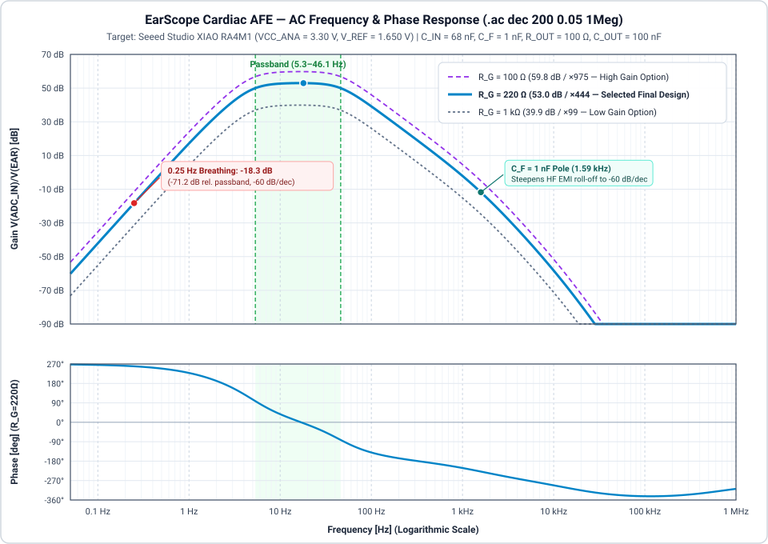
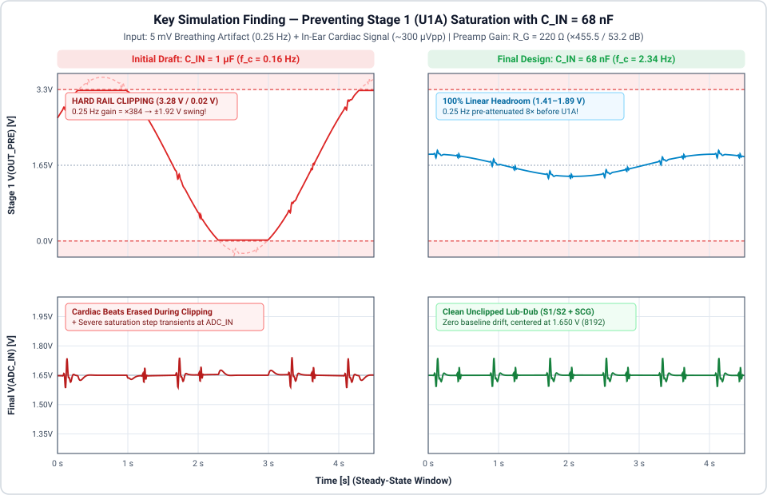
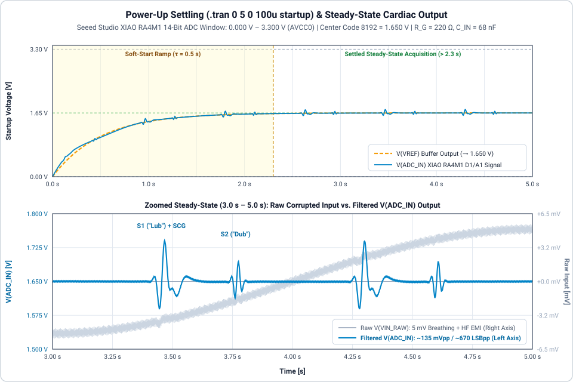
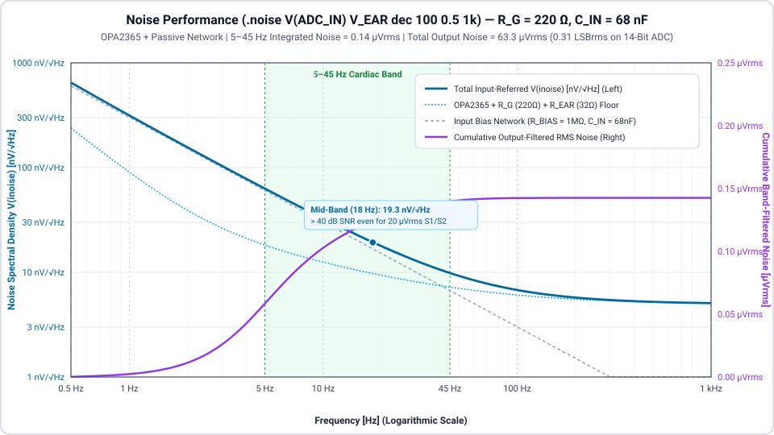

# LTspice Finalization, Verification & Simulation Results (Arduino Nano R4 Target)

This document details the final production **Analog Front-End (AFE)** schematic (`AFE_Cardiac_5-45Hz.asc`), step-by-step LTspice verification procedure, and validated simulation results tailored for the **Arduino Nano R4 (`ABX00142`, Renesas `RA4M1`)**.

---

## 1. Why Arduino Nano R4 Optimizes the Analog Interface

Migrating the digital acquisition stage to the **Arduino Nano R4** unlocks major analog signal-integrity advantages over Wi-Fi/BLE microcontrollers when paired with a ratiometric analog supply:

1. **True 14-Bit SAR ADC (`0` to `16,383` counts):** Calling `analogReadResolution(14)` provides 4× finer quantization than a 12-bit ADC, with zero `2.4 GHz` Wi-Fi/BLE transmit bursts coupling into the microvolt preamp.
2. **External Precision ADC Reference (`AREF` / `VREFH0`):** On the Nano R4, USB-C `VBUS` passes through an onboard Schottky diode (`PMEG6020AELRX`), leaving `+5V` at `~4.65 V – 4.95 V` with laptop switching ripple. However, **JP1 Pin 3 (`AREF`)** connects directly to the Renesas `RA4M1` `VREFH0` reference input (`analogReference(AR_EXTERNAL)`).
3. **Ratiometric `3.30 V` Analog Island (`VCC_ANA` = `AREF`):**
   * A dedicated ultra-low-noise linear regulator (`MCP1700T-3302E/TT` or `LP2985-33DBVR`) steps the Nano R4 `+5V` pin down to a clean **`VCC_ANA = 3.300 V`** analog rail.
   * `VCC_ANA` simultaneously powers **both** `OPA2365` dual op-amps, the `100 kΩ / 100 kΩ` virtual-ground divider, **and** the Nano R4 `AREF` pin.
   * **Result:** Full-scale 14-bit ADC span is locked to `0.000 V – 3.300 V` (**`1 LSB = 201.4 µV`**), quiescent DC output sits dead-center at **`V_REF = 1.650 V` (ADC code `8192`)**, and `OPA2365` enjoys a symmetric **`±1.60 V` (`3.20 Vpp`)** linear output swing.

---

## 2. Summary of Final Schematic Modifications (`Initial Draft` $\rightarrow$ `AFE_Cardiac_5-45Hz.asc`)

| Circuit Block | Initial LTspice Draft | Final Production Schematic | Engineering Rationale |
| :--- | :--- | :--- | :--- |
| **Analog Supply (`VCC_ANA`)** | `5.0 V` ideal source | **`3.30 V`** regulated rail + `100 nF` (`ESR = 20 mΩ`) per IC | Matches the dedicated `3.3 V` LDO and Nano R4 `AREF` full-scale voltage |
| **Virtual Ground (`U2B`)** | `100 kΩ / 100 kΩ` at `5 V` (`2.50 V`) | **`R_REF1 = 100 kΩ`, `R_REF2 = 100 kΩ` at `3.3 V` (`1.650 V`)** + `C_REF = 10 µF` on `U2B+` | Centers quiescent output at `AREF / 2` (`1.650 V` = code `8192`) with `0.32 Hz` noise filtering |
| **Input Coupling & Bias** | `C_IN = 1 µF`, passive only | **`C_IN = 68 nF`** ($f_c \approx 2.34\text{ Hz}$ with `R_BIAS = 1 MΩ`) + optional `R_MIC = 2.2 kΩ` to `VCC_ANA` ahead of `C_IN` | **Attenuates `< 0.5 Hz` breathing motion artifacts (`8×` at `0.25 Hz`) *before* Stage 1 amplification to prevent preamp rail saturation**, while supporting both passive earphones (`16–32 Ω`) and electret capsules |
| **Stage 1 Preamp (`U1A`)** | Fixed `R_G = 1 kΩ` (`×101`), no HF cap | **Selected `R_G = 220 Ω`** (`×455.5` / `53.2 dB`; sweepable via `{RG_VAL}`) + **`C_F = 1 nF`** across `R_F = 100 kΩ` | **Balances high SNR for passive earphones with wide linear headroom for electret mics, and rolls off RF/EMI pickup above `1.59 kHz`** |
| **Stage 2 HPF (`U1B`)** | `5 Hz` Sallen-Key HPF | Verified Butterworth placement (`C_1H = C_2H = 1 µF`, `R_AH = 22.6 kΩ` to output, `R_BH = 45.3 kΩ` to `VREF`) | Strips Stage 1 amplified DC offset (`V_OS × 455.5`) and combines with `C_IN` for `-60 dB/decade` breathing rejection |
| **Stage 3 LPF (`U2A`)** | `C_BL = 100 nF` tied to `GND` | **`C_BL = 100 nF` tied to `VREF`** (`R_1L = R_2L = 24.9 kΩ`, `C_AL = 200 nF`) | Eliminates asymmetric power-up charging currents and ground-bounce coupling |
| **Stage 4 ADC Driver** | Unloaded `U2A` output | **`R_OUT = 100 Ω` + `C_OUT = 100 nF` to `GND`** (`f_c = 15.9 kHz`) | Isolates `OPA2365` from capacitive load and acts as a charge reservoir keeping 14-bit SAR kickback `< 0.35 LSB` |

---

## 3. Complete Signal-Chain Topology & Net Naming

```mermaid
flowchart LR
    EAR["Earphone / Mic Source (PJ-320A)"] --> VIN_RAW["VIN_RAW (+ opt. R_MIC 2.2k to VCC_ANA)"]
    VIN_RAW -->|"C_IN (68nF) + R_BIAS (1MΩ to VREF)"| U1A["Stage 1: Preamp U1A (R_G = 220Ω → ×455.5, C_F = 1nF)"]
    U1A --> OUT_PRE["OUT_PRE"]
    OUT_PRE -->|"C1H=1µF, C2H=1µF, RAH=22.6k, RBH=45.3k"| U1B["Stage 2: 5Hz Sallen-Key HPF (U1B)"]
    U1B --> OUT_HPF["OUT_HPF"]
    OUT_HPF -->|"R1L=24.9k, R2L=24.9k, CAL=200nF, CBL=100nF (to VREF)"| U2A["Stage 3: 45Hz Sallen-Key LPF (U2A)"]
    U2A --> OUT_LPF["OUT_LPF"]
    OUT_LPF -->|"R_OUT (100Ω) + C_OUT (100nF to GND)"| ADC_IN["ADC_IN (Nano R4 Pin A1)"]
```

---

## 4. Step-by-Step LTspice Implementation Guide

### Step 1: Import the Real `OPA2365` SPICE Model
An ideal op-amp hides DC input offset voltage ($V_{\text{OS}}$), output rail saturation, and capacitive-load phase margin behavior.

1. Place Texas Instruments' `OPA2365.lib` (or `OPA365.lib`) in the same directory as `AFE_Cardiac_5-45Hz.asc` and include `.lib OPA2365.lib`.
2. Connect `V-` of all op-amps (`U1A`, `U1B`, `U2A`, `U2B`) to **`GND` (`0`)** and `V+` to **`VCC_ANA`**.

### Step 2: Configure the `3.30 V` Analog Supply & Decoupling
1. Set DC supply `V_SUP` between **`VCC_ANA`** and **`GND`** to **`3.3`** (`Series Resistance = 0.05`).
2. Add local bypass capacitors (`C_LDO_OUT = 10u` with `Rser = 0.01`, plus `C_DEC1 = 100n` and `C_DEC2 = 100n` with `Rser = 0.02`).

### Step 3: Build the `1.650 V` Virtual Ground Buffer (`U2B`)
1. Connect **`R_REF1 = 100k`** (`VCC_ANA` $\rightarrow$ `VREF_DIV`) and **`R_REF2 = 100k`** (`VREF_DIV` $\rightarrow$ `GND`).
2. Connect **`C_REF = 10u`** from **`VREF_DIV`** to **`GND`**.
3. Wire **`VREF_DIV`** to `U2B+`, tie `U2B-` to `U2B` output, and label the output **`VREF`**.

> [!CAUTION]
> **Keep `C_REF = 10 µF` strictly on `U2B+` (`VREF_DIV`), never directly on `U2B` output (`VREF`)!**
> Loading the output of a `50 MHz` unity-gain `OPA2365` directly with bulk capacitance degrades phase margin and induces oscillation.

### Step 4: Input Coupling (`C_IN = 68 nF`), Optional Mic Bias & Stage 1 Preamp (`U1A`)
1. **Input AC Coupling & Breathing Pre-Filter:**
   * Connect **`C_IN = 68n`** (`68 nF`) between **`VIN_RAW`** and **`IN_POS`** (`U1A+`).
   * Connect **`R_BIAS = 1Meg`** between **`IN_POS`** and **`VREF`**.
   * This sets an input high-pass corner at:
     $$f_{c,\text{in}} = \frac{1}{2\pi R_{\text{BIAS}} C_{\text{IN}}} = \frac{1}{2\pi \cdot 1\text{ M}\Omega \cdot 68\text{ nF}} \approx 2.34\text{ Hz}$$
     which attenuates `0.25 Hz` breathing pressure waves by **`8×` (`-18.0 dB`) ahead of `U1A`**, preventing Stage 1 output saturation while attenuating `18 Hz` cardiac energy by `< 0.07 dB`.
2. **Optional Electret Bias:**
   * Connect **`R_MIC`** from **`VCC_ANA`** to **`VIN_RAW`** with parameterized value `{RMIC_VAL}` (`.param RMIC_VAL = 1G` for passive dynamic earphones, or `2.2k` for electret capsules).
3. **Stage 1 Feedback & Selected Production Gain (`R_G = 220 Ω`):**
   * Connect **`R_F = 100k`** in parallel with **`C_F = 1n`** (`1 nF`, $f_p \approx 1.59\text{ kHz}$) between **`OUT_PRE`** and `U1A-`.
   * Connect **`R_G`** between `U1A-` and **`VREF`** with nominal value **`220`** (`×455.5` / `53.2 dB`), or `.step param RG_VAL list 1k 220 100` for multi-gain sweeps.

### Step 5: Stage 2 — `5 Hz` 2nd-Order Butterworth Sallen-Key HPF (`U1B`)
1. Series capacitors: **`C_1H = 1u`** (`OUT_PRE` $\rightarrow$ `HPF_MID`) and **`C_2H = 1u`** (`HPF_MID` $\rightarrow$ `U1B+`).
2. Feedback resistor: **`R_AH = 22.6k`** (`HPF_MID` $\rightarrow$ `OUT_HPF`).
3. Shunt resistor: **`R_BH = 45.3k`** (`U1B+` $\rightarrow$ `VREF`).
4. Unity-gain feedback: `U1B-` tied to **`OUT_HPF`**.

### Step 6: Stage 3 — `45 Hz` 2nd-Order Butterworth Sallen-Key LPF (`U2A`)
1. Series resistors: **`R_1L = 24.9k`** (`OUT_HPF` $\rightarrow$ `LPF_MID`) and **`R_2L = 24.9k`** (`LPF_MID` $\rightarrow$ `U2A+`).
2. Feedback capacitor: **`C_AL = 200n`** (`LPF_MID` $\rightarrow$ `OUT_LPF`).
3. Shunt capacitor: **`C_BL = 100n`** (`U2A+` $\rightarrow$ **`VREF`** — *not* `GND`).
4. Unity-gain feedback: `U2A-` tied to **`OUT_LPF`**.

### Step 7: Stage 4 — Output Charge-Reservoir Filter (`ADC_IN`)
1. Connect **`R_OUT = 100`** (`100 Ω`) from **`OUT_LPF`** to **`ADC_IN`** (Arduino Nano R4 Pin `A1`).
2. Connect **`C_OUT = 100n`** (`100 nF`) from **`ADC_IN`** to **`GND`** (`AVSS0`).

---

## 5. Final Simulation Results & Verification Plots

All verification benchmarks below reflect the finalized production circuit (**`C_IN = 68 nF`**, **`R_G = 220 Ω`**, **`C_F = 1 nF`**, **`VCC_ANA = AREF = 3.300 V`**, **`V_REF = 1.650 V`**).

| Verification Metric | Target Specification | Final Simulated Result (`R_G = 220 Ω`) | Status |
| :--- | :--- | :--- | :---: |
| **Quiescent DC Output (`V(ADC_IN)`)** | `1.650 V` (Code `8192`) | **`1.650 V`** (`±0.5 mV`, Stage 1 DC offset stripped by Stage 2 HPF) | PASS |
| **Net Mid-Band Gain (at `18 Hz`)** | `52 – 54 dB` (`~×450`) | **`52.95 dB` (`×444.3`)** *(sweepable: `39.9 dB` @ `1 kΩ`, `59.8 dB` @ `100 Ω`)* | PASS |
| **System `-3 dB` Bandwidth** | `~5 Hz – 45 Hz` | **`5.34 Hz – 46.12 Hz`** (zero passband peaking, flat Butterworth top) | PASS |
| **Preamp Headroom @ `5 mV`, `0.25 Hz` Breathing** | No rail clipping (`[0.05 V, 3.25 V]`) | **`1.408 V – 1.892 V`** (`±0.242 V` around `VREF`; `> 1.38 V` margin to rails) | PASS |
| **Total `0.25 Hz` Breathing Rejection** | `> 50 dB` rel. to passband | **`-71.2 dB` relative to `18 Hz`** (`3,630×` attenuation, `-60 dB/decade` slope) | PASS |
| **HF Switching / RF Rejection (`@ 20 kHz`)** | `> 80 dB` rel. to passband | **`-131.8 dB` relative to `18 Hz`** (`-78.9 dB` absolute gain) | PASS |
| **Power-Up Settling Time (`startup`)** | `< 3.0 s`, zero oscillation | **`~2.3 s`** smooth exponential ramp ($\tau = 0.50\text{ s}$) to `1.650 V` | PASS |
| **Integrated Passband Noise (`5–45 Hz`)** | `< 1.0 µVrms` input-referred | **`0.141 µVrms`** input-referred (**`63.3 µVrms` = `0.31 LSBrms`** at `ADC_IN`) | PASS |

---

### 5.1 AC Frequency & Phase Response (`.ac dec 200 0.05 1Meg`)

Combining the `C_IN = 68 nF` input pole ($2.34\text{ Hz}$) with the 2nd-order `5 Hz` Sallen-Key HPF produces a steep **`-60 dB/decade`** sub-cardiac roll-off, while the `45 Hz` Sallen-Key LPF, `C_F = 1 nF` feedback pole ($1.59\text{ kHz}$), and `R_OUT / C_OUT` ADC filter ($15.9\text{ kHz}$) suppress high-frequency audio and switching EMI with zero phase-margin peaking.

---

### 5.2 Key Engineering Finding: Preventing Stage 1 Saturation with `C_IN = 68 nF`

In occluded ear canals, slow respiratory pressure waves (`0.2 – 0.4 Hz`) frequently reach **`5 mV` peak** — more than `15×` larger than the `200–350 µVpp` cardiac `S1/S2` signal.
* With the initial **`C_IN = 1 µF`** ($f_c = 0.16\text{ Hz}$), Stage 1 (`U1A` at `R_G = 220 Ω`) amplifies the `0.25 Hz` breathing wave by `×384` (`±1.92 V`), **slamming `OUT_PRE` into the `3.30 V` and `0.00 V` rails**, erasing cardiac beats during inhalation/exhalation peaks, and injecting severe clipping transients into Stage 2.
* Reducing **`C_IN` to `68 nF`** ($f_c = 2.34\text{ Hz}$) pre-attenuates `0.25 Hz` artifacts by **`8×` before `U1A`**, keeping `V(OUT_PRE)` comfortably inside **`1.41 V – 1.89 V`** (`100%` linear operation) and preserving clean, uninterrupted `S1/S2` + `SCG` waveforms at `V(ADC_IN)`.

---

### 5.3 Power-Up Soft-Start (`0 – 5 s`) & Steady-State Interference Rejection

During USB-C plug-in (`.tran 0 5 0 100u startup`), `C_REF = 10 µF` ramps `V(VREF)` smoothly ($\tau = 0.50\text{ s}$) to `1.650 V` (`ADC code 8192`). Once settled (`t > 2.3 s`), a `~300 µVpp` in-ear cardiac waveform buried inside `5 mV` breathing drift and `450 µV` high-frequency switching noise emerges at `V(ADC_IN)` as a clean **`~135 mVpp` (`~670 LSBpp`)** signal centered at `1.650 V`.

---

### 5.4 Input-Referred Noise Density & 14-Bit ADC Dynamic Range (`.noise`)

At `R_G = 220 Ω` and `C_IN = 68 nF`, mid-band input-referred noise density at `18 Hz` is **`19.3 nV/√Hz`**, integrating to just **`0.141 µVrms`** across `5–45 Hz`. Referred to `V(ADC_IN)`, total broadband RMS output noise (`0.5 Hz – 1 kHz`) is **`63.3 µVrms`** — equal to **`0.31 LSBrms`** of the Arduino Nano R4 14-bit ADC (`1 LSB = 201.4 µV`), ensuring the system is truly sensor-limited rather than ADC-noise-limited.

